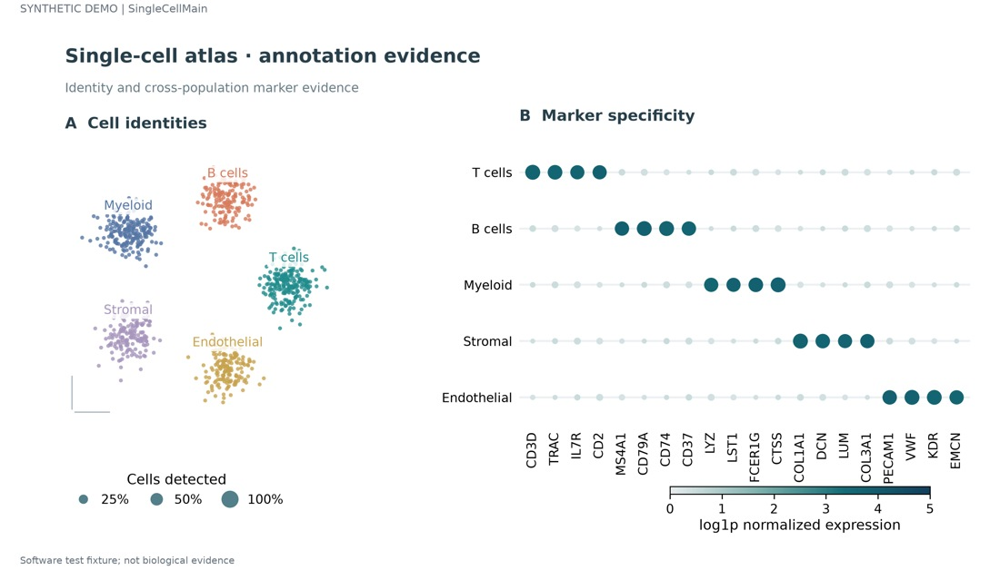
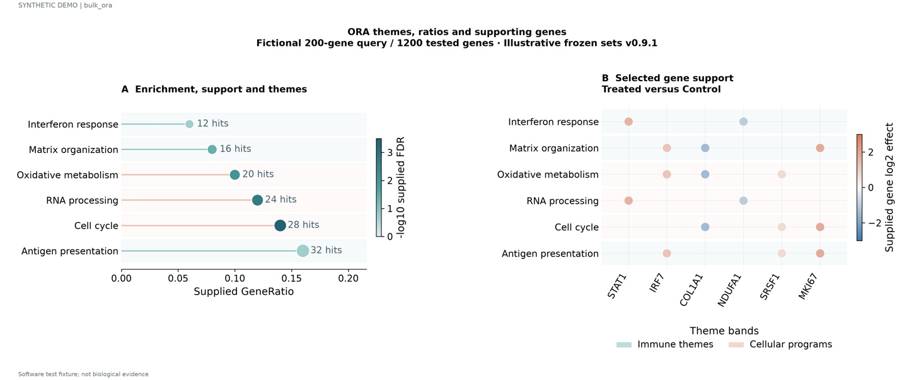
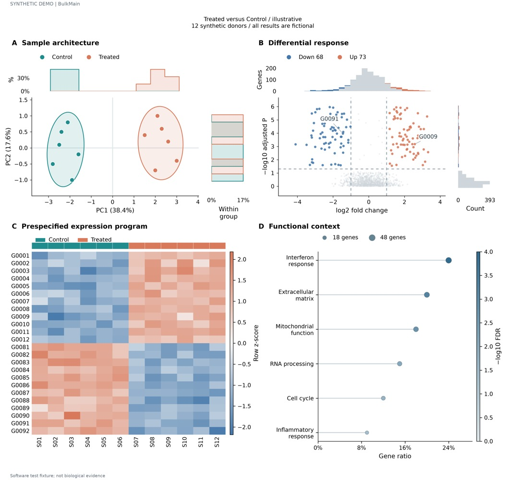
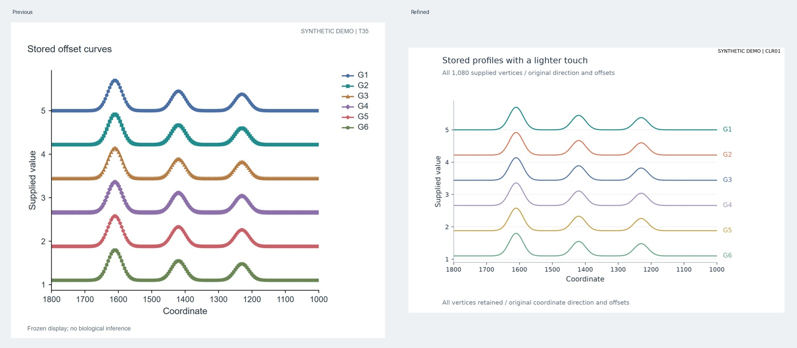
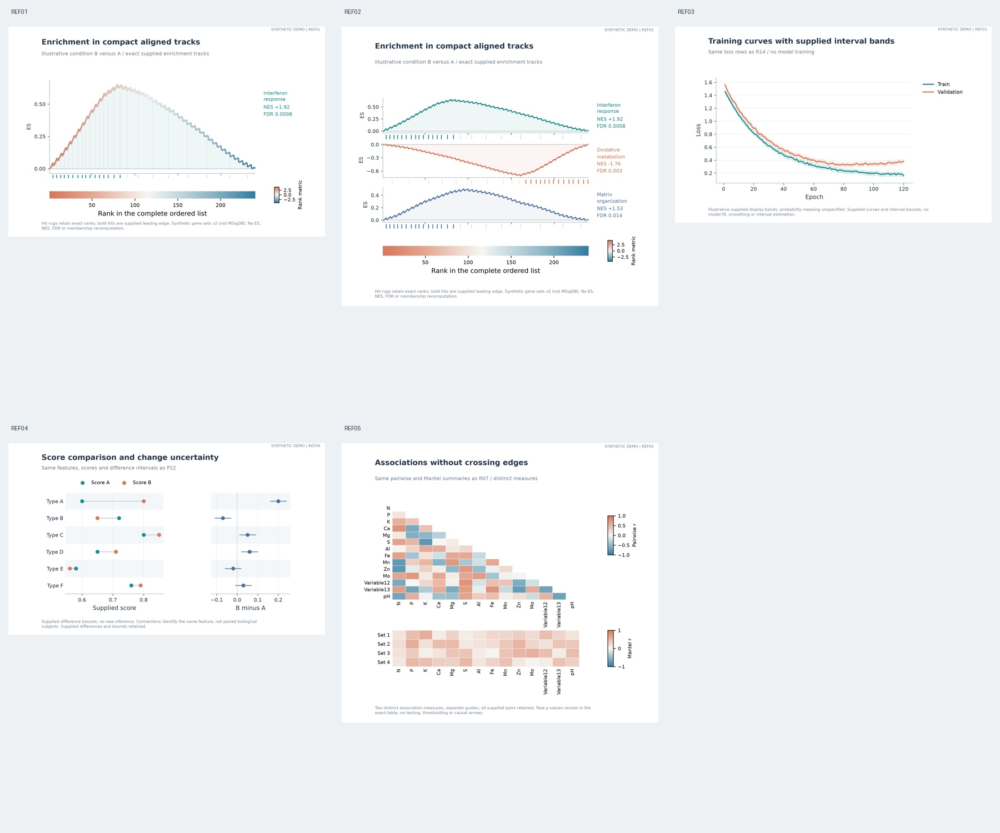
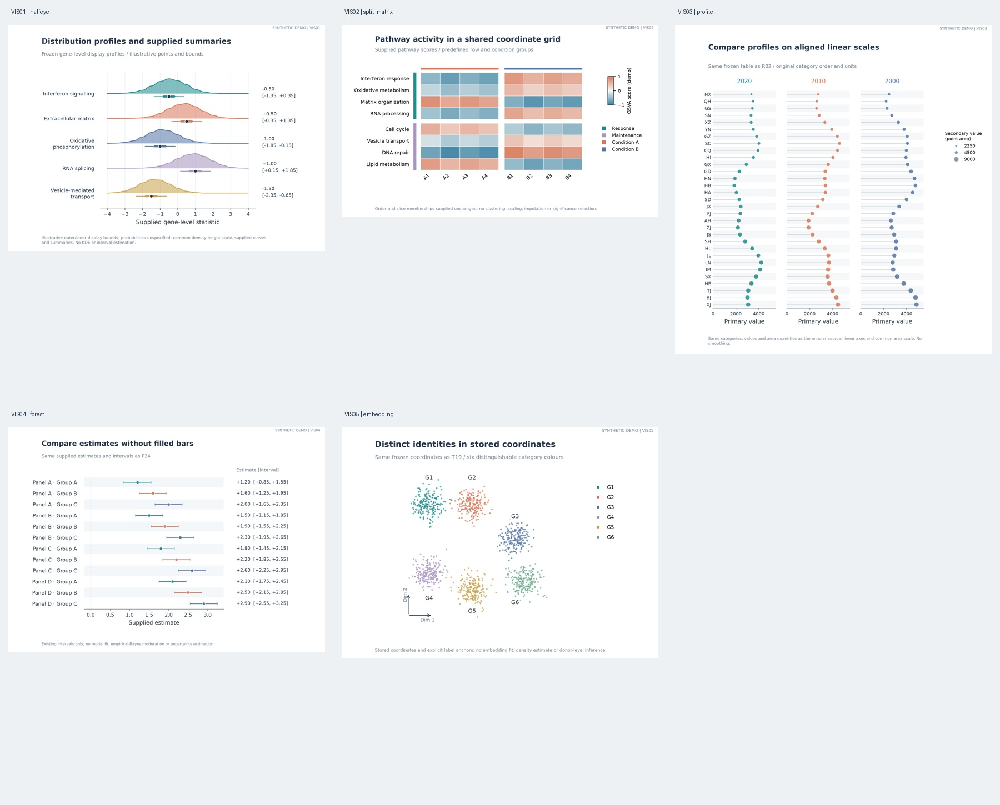
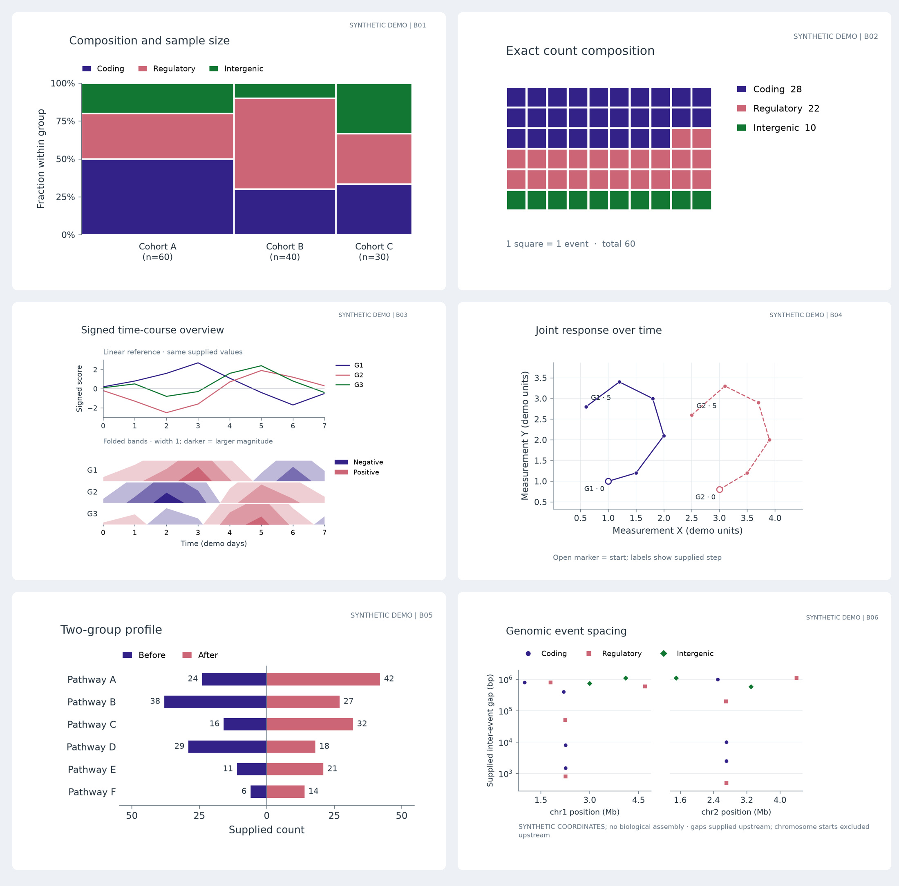
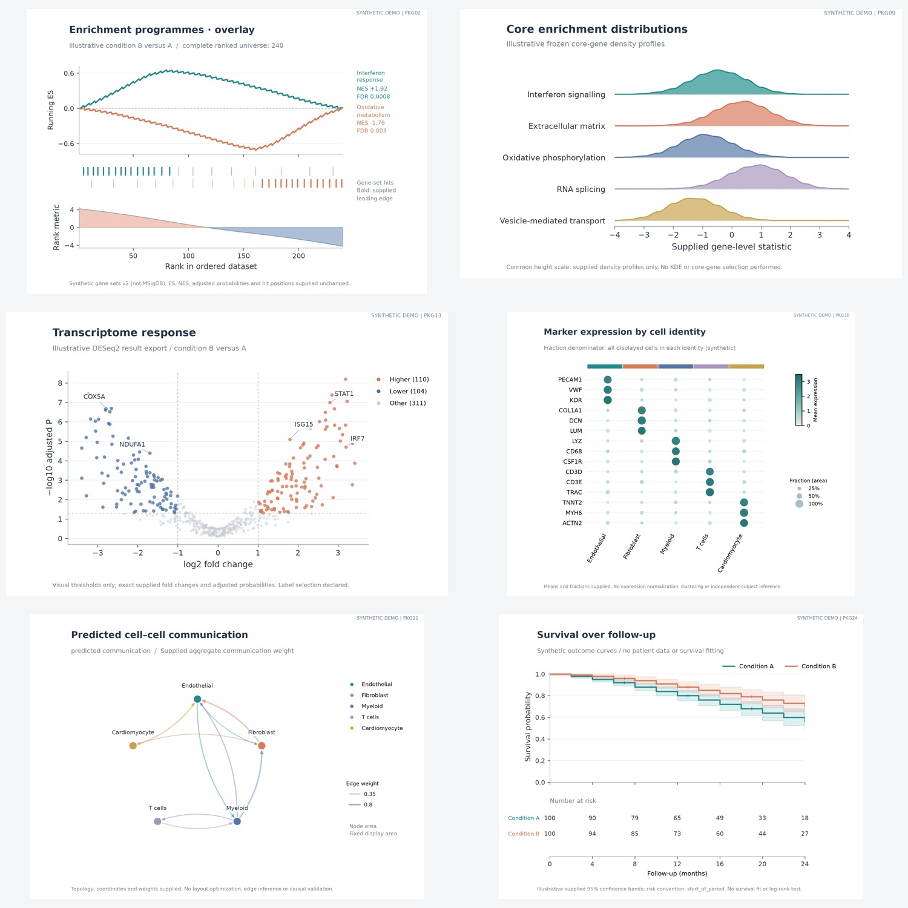
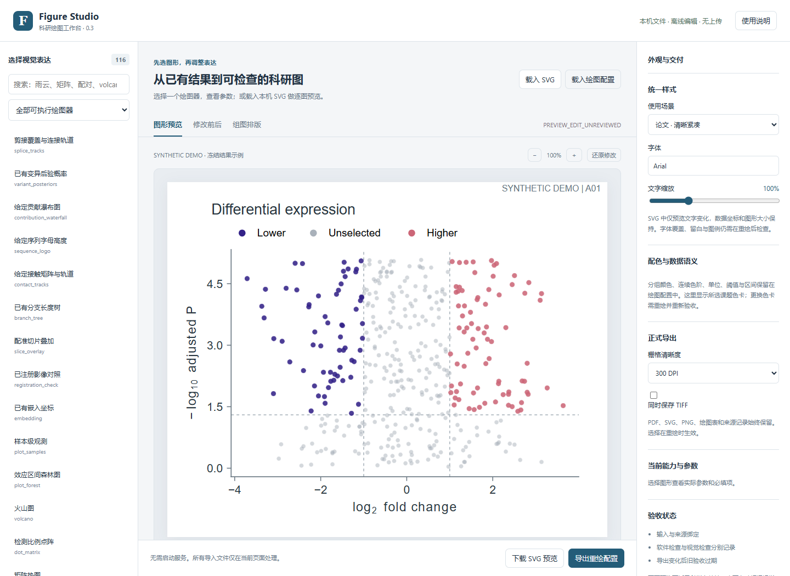

# 综合科研绘图工作台 · Scientific Figure Workbench

## 综合绘图库：多组学、计算生物学与计算机建模

[打开完整绘图库](skills/transcriptomics-figure-workbench/assets/visual-library/index.html) · [方法覆盖与真实状态](skills/transcriptomics-figure-workbench/references/visual-library-coverage.md) · [跨领域选图规则](skills/transcriptomics-figure-workbench/references/comprehensive-selection.md)

- **恢复完整范围：** 主目录覆盖21份图库；原有90个基础画法、458个历史示例及原始入口全部保留。雷达、三维曲面、环形网络、结构、质谱、基因组轨道和模型评估保持可选，新增三维散点、体渲染和分子轨迹动画。
- **按画法去重，扩展仍可选：** 原基础画法、3种新增方法与专用配套归入86个父族，箱线／小提琴／云雨、矩阵注释／相关／状态等在同一父族内具名选择。不同数据、配色和布局不重复占据主菜单；分析、量尺、分母和准确文件分别保留。
- **覆盖可以核对：** 2247条来源记录指向1697个保留示例条目，其中1239个当前示例、458个历史条目；它们不是独立方法数。136个登记绘图入口中135个有当前可调用 FigureSpec，1个是单面板委托封装。42个原历史配方已全部升级；示例数量不等于算法数量。
- **综合检索与真实模板：** `visual-library --search 雷达` 跨领域查找；`visual-template --entry radar --output <fresh-directory>` 导出当前可运行配置与原始冻结表。历史参考明确区分，不伪装成可执行 FigureSpec。原有命令及目录名称继续兼容。

当前增加 [45种方法的小／中／大数据及自定义布局实测](skills/transcriptomics-figure-workbench/assets/method-scale-gallery/index.html)：135份不同冻结输入、45份同一大输入的自定义布局，共180份单图及45份完整SVG组装页；[逐项数据量、改进和检查范围](skills/transcriptomics-figure-workbench/references/method-scale-validation.md)均可核对。上一轮[93份单图和45份组装页](skills/transcriptomics-figure-workbench/assets/method-upgrade-gallery/index.html)原字节保留。每份最终PNG有逐张屏幕检查记录和图片哈希；作者自检不等于独立审美评审或纸面校样。

- **改的是实际画法：** 森林图按行对齐区间与数值；长类别点区间和数值条自动横向；双通道矩阵分离注释带与标签；富集曲线补齐命中数、完整rank轨道及对比色；PCA优先给定轮廓和边缘分布；密集模型组图拆出完整阅读布局。
- **实际改变布局：** 支持不同物理宽度，跨视图由横向改为单列，流程和多类别贡献图改变列数，三维图改变相机／投影／切片／关键帧数量；每种均保留同一完整输入作对照。大型长页按原尺寸阅读，不压成期刊单栏后仍声称可读。
- **直接调用实测模板：** `visual-template --entry Scale_H02_forest_Large --output <fresh-directory>`；三维使用 `Scale_D01_Scatter3D_Custom`、`Scale_D02_Volume_Custom`、`Scale_D03_Trajectory_Custom`。旧短编号继续兼容。

### 当前可调用的历史配方与三维方法

- **42个配方：** 每种都有当前 FigureSpec、原字节冻结 TSV、默认／自定义布局、PNG／SVG／PDF，以及完整双图组装示例。可直接使用 `visual-template --entry H02_forest --output <fresh-directory>`；原历史编号继续指向原归档。
- **三维散点：** 多个明确相机视角与完整 XY／XZ／YZ 投影；支持显式列数、行数、宽度和面板高度。所有点和原始坐标保留。
- **体渲染：** 对完整规则物理体素执行前向透明度合成，支持有限预算的正交三维相机、六个轴向观察方向、透明度传递曲线和中央物理切片；8³／16³／24³同一物理范围实例可比较。三线性采样仅用于绘图，不改变源体素；不声称已集成VTK或交互飞行浏览。
- **分子轨迹：** 对已给定的原子坐标、明确键和物理时间生成关键帧、真实 GIF、完全离线的逐帧播放页及帧时间记录。6／12／24帧及不同相机、行列布局可直接查看；不运行分子动力学、不猜测键、不自行做对齐或周期边界处理。

当前示例可离线浏览，历史版本的完整归档下载沿用既有公开链接。结构固定参考、绘图代码、原生软件包运行和真实科学分析分别记录；新数据、新布局和投稿尺寸须重新看图。

## 图册去重与阅读顺序修订

[打开转录组分析子目录](skills/transcriptomics-figure-workbench/assets/analysis-library/index.html) · [去重规则与统计范围](skills/transcriptomics-figure-workbench/references/navigation-dedup.md)

- **分析子目录的统计：** 550份转录组来源示例归入103个可复用画法族，默认显示76族。这仅是分析子目录，不是综合绘图库的全部方法。热图、效应区间、云雨图等的不同数据示例，以及近似的单列／三列版在条目内切换。
- **保留按分析阅读：** 可切换回58章的分析问题目录，互补的QC、主结果、支持和验证仍可分别选取。画法合并没有删除科学问题或更改输入数据。
- **固定顺序和原链接：** 浏览模式与扩展选项切换保留当前图；550个旧图ID全部可达，常规图库的旧数字链接和前版比较也保留。
- **计数更准确：** 550表示来源文件页，103表示可复用画法族；不同图库有重叠，不能相加作为算法总数。旧说明中“550个去重实际图页”指去除了重复文件引用，未处理近似画法，现已纠正。

## v0.10.0 逐分析的完整配套画法

[58章统一分析目录](skills/transcriptomics-figure-workbench/assets/analysis-library/index.html) · [逐项问题与画法清单](skills/transcriptomics-figure-workbench/references/analysis-companion-coverage-v100.md) · [实际配套示例](skills/transcriptomics-figure-workbench/assets/companion-gallery/index.html) · [完整配套图册 PDF](skills/transcriptomics-figure-workbench/assets/companion-gallery/All_Analysis_Companions.pdf)

- **按分析交付整套图：** 保留 WGCNA／hdWGCNA 的建网、模块、性状、功能和验证路线，其余56章分别补充输入/QC、主结果支持、效应与不确定性、功能解释和敏感性／独立复现。剪接、VDJ、空间、velocity、Perturb-seq等按实际数据前提选择。
- **统一目录可逐项查找：** 58个分析章节连接597个调用视图与550份来源文件页；当前按103个可复用画法族导航，单面板入口、替代画法、组图和布局分别统计。
- **有代码、有表、有实际导出：** 配套库包含307份单项图、56份互补组图、56份扩展数据单列阅读版及6份三列版，共425份明确虚构的冻结示例。每份提供 PNG／SVG／PDF、可运行配置和准确 TSV；布局数量不计作新分析算法。
- **默认丰富且有依据：** 专用 PCA、火山/MA、GSEA、逐亚群多marker主图继续使用；供体分布优先保留全部点与给定云形，效应图带独立对齐数值区，比例图保留完整类别和分母，物理基因座保留参考版本、链与真实区间尺度。
- **布局随内容调整：** 森林图行高随条目数增长，组图按各行内容分配高度，支持显式行列和物理尺寸。单列长页用于完整阅读；投稿尺寸须另行测量并复看，不能把宽版缩小后的小字当作合格。
- **逐图审阅再发布：** 新导出必须有与最终 PNG 哈希一致的单张审阅记录，同时检查信息完整性、数值范围、独立样本数及布局。打包程序拒绝遗漏、失败或过期的图片审阅。

这些是绘图实现与可复用示例，没有在本机运行真实组学推断。没有上游区间时不补造区间，没有冻结云形时不拟合密度；独立队列复现、相同供体的替代模型和真实后端验收分别记录。[输入与选择协议](skills/transcriptomics-figure-workbench/references/analysis-companion-protocol-v100.md) · [来源与采用范围](skills/transcriptomics-figure-workbench/references/analysis-companion-sources-v100.md) · [本轮逐图审阅和验收范围](skills/transcriptomics-figure-workbench/references/validation-v100.md)

按**数据结构与想表达的问题**选择图形，保留原始数值与参考图的视觉语言，用一套课题色卡和字体统一所有图。可安装为 Codex skill，也可以直接使用 Python/R 的冻结结果表绘图器。

本版为 **v0.10.0**。优先选择信息更完整且易读的美化扩展，并按 **58个分析章节**组织 bulk 与单细胞绘图：每章提供实际代码、可运行模板、准确模拟表和导出实例。90个合并导航条目与458个历史编号继续保留，近似画法作为扩展。

## v0.9.7 按分析取整套图，补齐 WGCNA 配套展示

[按分析浏览完整目录](skills/transcriptomics-figure-workbench/assets/analysis-library/index.html) · [本轮43份实际导出](skills/transcriptomics-figure-workbench/assets/analysis-gallery/index.html) · [43页图册](skills/transcriptomics-figure-workbench/assets/analysis-gallery/Analysis_Companions_FigureBook.pdf) · [分析套件与调用](skills/transcriptomics-figure-workbench/references/analysis-library-v097.md) · [来源、数据契约与验收范围](skills/transcriptomics-figure-workbench/references/analysis-completion-v097.md)

- **WGCNA 从一张章节图变成分阶段套件：** 设计／样本与软阈值诊断、基因树和模块、带树及注释的 TOM、模块规模与未分配基因、模块–性状、MM–GS、特征基因关系与供体云雨、枢纽网络、功能支持基因、供体效应、差异连接、跨队列重叠、投影覆盖、保留性属性和敏感性。hdWGCNA 另接供体／metacell 支持及共同坐标活动图。
- **其他分析接入配套画法：** GSVA／通路评分有供体分布和调整后对比，TF／regulon 有活性效应与有向靶基因证据，PPI 明确区别共表达边，剪接有供体 PSI 分布，轨迹有固定分支的程序曲线与上游区间。原有58章统一可查，通路、细胞通讯、CNV、VDJ、空间和多组学等不会再被常规图库的少数示例遮住。
- **普通请求按整套选择：** `analysis-library --search WGCNA` 查路线；`analysis-suite --chapter bulk.wgcna --output <fresh-directory>` 一次导出该分析的默认合成模板、准确 TSV 与批量绘图清单。近似画法和布局须加 `--include-variants`；真实结果仍逐项通过 `book-plan` 绑定，不能因模板存在就推断对应分析已完成。
- **实际做数据量和布局检查：** 本轮43份包含14份既有专用诊断的重新导出、23份新增配套实例与6份模块数／供体数／单列三列等布局实例。它们是图页与布局数量，不是43种科学算法。每份有 PNG／SVG／PDF、输入和最终图片审阅绑定；新数据、新参数和新尺寸须重新审图。

所有新示例都是明确虚构的绘图测试材料；未在本地运行 WGCNA、GSVA、轨迹或剪接分析，也没有把第三方软件的分析算法移植为本项目原创。来源、网络含义、量尺、统计区间和独立供体边界按实际返回结果保留。绘图覆盖范围与分析后端验证分开记录。

## v0.9.6 整套默认画法逐张返工

[本版43张完整图与前版切换对照](skills/transcriptomics-figure-workbench/assets/routine-gallery/index.html) · [43页完整PDF](skills/transcriptomics-figure-workbench/assets/routine-gallery/Bulk_and_SingleCell_FigureBook.pdf) · [逐图选择和实际验收](skills/transcriptomics-figure-workbench/references/publication-defaults-v096.md)

- **先选合适的丰富画法：** PCA保留给定椭圆、完整边缘比例、解释方差；火山/MA保留全部基因及堆积分布。森林图使用紧凑对齐的名称、区间和数值列。
- **分布、相关性与组成重排：** QC与基因表达优先半云+全部点+窄箱；相关性显示唯一配对的三角矩阵、贴近色条及描述性摘要；细胞组成同时显示每位供体的完整比例与逐亚群供体分布。
- **富集按信息密度选：** 单对比采用清楚的比例/NES轴、精确FDR和重叠数；稀疏的成员证据独立成页。GSEA保留完整ES、命中、leading edge、排序指标与单通路阅读版。
- **单细胞证据齐全：** 全局身份图谱、20个marker均值与检出率、共同坐标特征图、五个亚群各四marker证据页。批次页补充批次×身份的真实显示计数。
- **逐张检查才更新：** 本版43张最终导出绑定逐图屏幕自检记录，前后43份TSV逐字节相同；另检查小/大数据量和自定义布局。新输入或新布局须重新看图。示例字号检查不能代替实际投稿尺寸校样。

全部使用明确虚构的冻结结果，未做真实转录组推断；不将此前历史图库的检查范围重复算作本轮成果。现有通用入口和显式经典画法仍可选，常规研究请求优先从本版完整示例选择。

## v0.9.5 普通常规指令的完整出图与默认画法返工

[43份完整模拟出图，逐张浏览](skills/transcriptomics-figure-workbench/assets/routine-gallery/index.html) · [43页矢量PDF图册](skills/transcriptomics-figure-workbench/assets/routine-gallery/Bulk_and_SingleCell_FigureBook.pdf) · [范围、修订与复现](skills/transcriptomics-figure-workbench/references/routine-study-audit.md)

- **普通指令实际演练：** 同一套明确虚构的12供体、900细胞与1,200基因结果，生成15份bulk默认图、23份单细胞默认图及5份阅读/自定义布局。每图可查看完整PNG/SVG/PDF、冻结输入和参数，另有可直接用于 `study-plan` 的两套清单。
- **分布优先云雨：** 逐基因表达、bulk表达QC和单细胞三指标QC均提供半云、全部观测点与窄箱体；明确供体数、基因数和细胞数。云形与带宽预先冻结，小样本点全部保留，不在绘图中拟合密度或虚构置信区间。
- **森林、热图与富集重排：** 森林图三列对齐，行高随条目数调整；热图注释贴近矩阵；三通路GSEA使用平衡分面，保留单通路与横排版；单对比NES摘要直接展示正负效应轴。
- **逐亚群多marker成为完整请求的一部分：** 五个身份各有四marker页，定位、跨群均值/检出率和完整细胞表达图连续阅读；支持明确身份id与自定义行列。单细胞差异/通路部分明确限定Myeloid供体对比。
- **逐张屏幕自检和内容一致性分开：** 43份最终PNG逐张查看，记录绑定具体图片哈希；同时检查共享坐标/表达、GSEA命中与leading-edge、ORA分母。屏幕自检不代表独立审美评审、纸面校样或科学分析验收。

这是对模拟冻结结果的绘图演练，没有执行真实bulk/单细胞分析。以往图库和审阅范围保留；当前普通请求优先使用这组返工后的示例，新数据与新尺寸须重新检查。

## v0.9.4 原图参考落实到代码、实际示例与灵活布局

[96个当前完整单图视图](skills/transcriptomics-figure-workbench/assets/source-gallery/index.html) · [三档数据量与48个组图布局](examples/source-v093/index.html) · [90个图型逐项来源与实现](skills/transcriptomics-figure-workbench/references/source-design-v093.md) · [实际验收范围](skills/transcriptomics-figure-workbench/references/validation-v093.md)

- **逐类对照原图：** 新增34条实际看过的原图/作者示例来源，连同此前8条图形记录共42条。90个基础图型都连接到来源、采用与舍弃、实际代码和完整示例。优先2025–2026年的研究图，保留有用的更早作者方案；相关组件借鉴不冒充90张同型近年期刊原图。
- **改到绘图代码：** 点阵支持身份计数旁栏、真实零面积和独立面积/色标；组成图增加共用100%分母的分面对比；ROC/PR支持明确供应界限和阶梯语义；密集带符号网络优先矩阵，未报告值遮罩；三维网格增加完整二维表达，圆形网络与曲面保留为扩展。
- **解决实际版式问题：** 长标签避让、两节点弦图弧线、轨道分块留位、雷达身份区分、生存曲线线型、一致性界限边距、通路物理标框、切片/特征图宽度比例和示意图留白均落实到实现。原有统计量和坐标不为美化而重拟合。
- **逐张验收当前导出：** 96个单图视图、261个小/中/大数据量变体、48个平衡/自定义组图，共405份最终PNG逐张自检并绑定哈希。另复看3份PDF栅格化结果。数量是显示与布局实例，不是405种分析算法，也不代表所有历史图片重新通过。
- **可以实际复现：** 355份原生单图和数据量示例提供冻结TSV与 `example.spec.json`，经统一 `plan`、`render` 接口使用；安装包含完整的96视图与本地输入，Studio优先导航到当前版本。组图保留可检查的跨列、列宽权重及完整SVG参数。

新数据、新长标签、主题和尺寸不能沿用示例的审阅结论。大幅阅读布局不保证缩到期刊栏宽仍清楚；实际投稿需按目标物理尺寸重新看图。所有新数量和布局测试均为明确虚构的软件样例，未做新的科学分析。

v0.9.4补修了候选v0.9.3在跨系统、较新Matplotlib环境中的验收问题：区分跨系统弧线舍入与冻结数值变化，明确保留径向柱的原始高度，并将旧点阵测试同步到已审阅的面积尺度。图形修订档案继续使用 `source-v093` 路径，未发布的候选标签保留用于追溯。

## v0.9.2 逐类期刊检索与版式修订

[27个修订与布局示例，含修订前对照](examples/editorial-v092/index.html) · [90个图型逐项选择与检索](skills/transcriptomics-figure-workbench/references/journal-form-review-v092.md) · [近期期刊图形设计的采用与舍弃](skills/transcriptomics-figure-workbench/references/journal-design-v092.md)

- **逐类寻找：** 90个现有基础图型均有检索记录，优先2025–2026年。另实际阅读7篇论文的图注并查看8张原图，覆盖 Nature、Nature Methods、Nature Biotechnology、Nature Immunology、Nature Genetics、Nature Medicine 和 Nature Communications。29个基础图型有相关的已审阅设计来源；其他图型保留已有验证画法，候选检索不冒充原图审阅。
- **富集页重新组织：** 通路行对齐、单一标签区、清楚的NES/FDR含义；成员格明确区分非成员和零效应成员，注明基因效应所属对比。纵向阅读版的色标与标题独立留位。
- **逐亚群证据页：** 先定位与跨群特异性，再连续展示所选marker；支持2/4/8/12个marker、自适应列数和显式网格。完整细胞背景、坐标及共同表达范围保持不变。
- **实际验收范围：** 23个旧示例沿用相同冻结输入并更新导出，另4个明确虚构的marker数量样例用于布局检查；27份最终PNG逐张屏幕复看并绑定哈希。碰撞检查、屏幕自检、纸面校样与科学有效性分别记录。

不复制出版商图片、第三方脚本或模型。默认画法按信息表达与可读性选择；近期论文中拥挤的小字、彩虹尺度和过多雷达轴也会明确舍弃。所有候选与逐图审阅的范围保留在记录中。

安装包内的 Studio 使用92张可随包读取的导航预览（90个基础图型与2张课题示例）；完整历史导航保留在仓库示例与完整审阅库下载中，避免安装后出现指向仓库外部目录的旧预览。[本轮实际检查范围](skills/transcriptomics-figure-workbench/references/validation-v092.md)。

## v0.9.1 丰富默认画法与完整分析章节

[当前默认图组](skills/transcriptomics-figure-workbench/assets/study-gallery/index.html) · [58个章节的实际出图](skills/transcriptomics-figure-workbench/assets/chapter-gallery/index.html) · [章节、输入和调用方法](skills/transcriptomics-figure-workbench/references/transcriptomic-chapters-v091.md) · [社区方案的取舍](skills/transcriptomics-figure-workbench/references/rich-defaults-v091.md)

**版式验收已收紧：** 撤回拥挤旧总图作为默认方案的推荐，保留[被否定的候选](examples/rejected-v091/README.md)供对照。每个亚群现在有单独的多 marker 证据页，支持完整背景、跨群特异性对照和可调布局。屏幕检查记录不等于美观认可或期刊接收。[具体返工与验收规则](skills/transcriptomics-figure-workbench/references/editorial-acceptance-v091.md) · [166份示例导出及检查范围](skills/transcriptomics-figure-workbench/references/validation-v091.md) · [45份较大数据量阅读布局](examples/chapter-layouts-v091/index.html)。

**更新已有安装时：** 使用 `tools/sync_public_skill.py` 先预览，确认后加 `--apply`。已有 `references/lps-profile.md`、私有目录和本地覆盖配置默认保留；其他已自定义的同名文件用 `--protect` 显式保护。该工具核对拷贝后的字节，保留额外文件，不自动合并用户改过的代码，也不提供事务回滚。不要直接用公开占位模板覆盖私人课题配置。

### 分析内部的画法也要齐全

当前目录绑定 **143个具体视图**，包括章节内的独立面板、**14份 WGCNA/hdWGCNA 专用实例**、**16份方法配套实例**和 **8份逐亚群 marker / 布局实例**。[逐项视图表与调用方法](skills/transcriptomics-figure-workbench/references/analysis-depth-v091.md) · [WGCNA 专用图库](examples/wgcna-v091/index.html) · [方法配套图库](examples/method-depth-v091/index.html) · [逐亚群 marker](examples/subgroup-v091/index.html)。这些是画法与显示实例数，不是独立分析算法数。

- **WGCNA：** power 拟合度与连接度、样本树、基因树与 dynamic/merged 模块条、r/p/q/n 模块性状图、signed/absolute MM–GS、TOM 与 1−TOM、eigengene 关系/供者分布、hub、保存性；hdWGCNA 补 metacell 供者支持和同坐标模块评分图。
- **其他方法配套：** 完整分辨率细胞流向、带根和分支的拟时序图、基因动态与供者支持、HVG 均值/离散度、四类模型诊断、junction/coverage/isoform 轨道、完整成员交集和流向、基因—通路关系与冻结矢量场。相近画法作为扩展复用。
- **先检查选择逻辑：** `choose` 根据研究问题、数据语义和独立单位选图；`chapter-views` 检索分析内部的画法；`view-template` 导出独立单图；同一分析/对比可用不同 `view` 保存诊断、解释图和阅读页。GSEA 摘要不能生成虚构 ES 曲线，ORA 不冒充有方向的活性结果。
- **重新审图：** 采用实际像素图和最终尺寸检查。代码通过、数值编码检查、屏幕自检、纸面印刷与科学分析验收分别记录；换数据或布局不沿用旧图的审阅结果。

上一版的11张 bulk、14张单细胞只是两套小示例。它们既不能代表完整工作台，也不应让最基础的散点图成为默认优选。旧图和当时的检查记录保留，当前推荐由下面这些扩展和章节替代。

| 场景 | 当前优先画法 |
|---|---|
| 样本 PCA | 有明确含义的供应椭圆、组内边际分布比例、样本点和解释方差；不在绘图时拟合置信区间 |
| 火山与 MA | 完整受检基因、堆积边际分布、清晰方向色、经过避让的选定标签 |
| 单细胞注释/亚群 | 总览显示身份与按注释分块的 marker 证据；逐亚群另页显示多个对应 marker、全细胞背景表达图与跨群特异性对照 |
| ORA | 主题分组、GeneRatio、命中数、FDR与选定基因的通路归属联合呈现 |
| GSEA | 完整ES、命中轨道、排序量与leading-edge；多通路对齐、跨对比NES和基因支持分别保留真实含义 |
| 完整课题 | 按分析章节组织多对比、多亚群、多队列的图册，另选互补面板组成主图 |

### 58个章节均有可执行绘图实例

- **28个 bulk 章节：** 设计、读段QC、比对/覆盖、过滤、归一化、批次/PCA、差异、交互、模型诊断、基因程序、ORA、GSEA、跨对比通路、基因—通路支持、多通路轨迹、GSVA、WGCNA、TF活性、去卷积、剪接、DTU、时间序列、独立复现、条件性生存关联、PPI、扰动签名、非编码RNA、融合证据。
- **30个单细胞章节：** 供者设计、barcode、QC、ambient/doublet、整合、HVG/PC、分辨率、注释、亚群复分析、marker、组成、丰度、pseudobulk、多细胞类型对比、通路及基因支持、状态分数、hdWGCNA、轨迹、velocity、通讯、ligand-target、regulon、CNV、VDJ、剪接、Perturb-seq、跨队列复现、空间和multiome。
- **可直接试画：** `chapters` 检索；`chapter-template` 导出一章的可运行模板；`book-plan` / `book-render` 按多个对比、亚群、队列保留独立身份。每章有完整输入要求、专用QC和解释边界，不用“待补”代替绘图实现。
- **布局继续可调：** 章节按实际面板数量自动排版，也可自定义列数；沿用独立单图、跨行跨列与分页组图。更换数据量、参数或尺寸后重新看实际导出。

这是一套冻结结果的绘图能力。所有新示例均使用明确标注的虚构输入，不等于这些分析已经在真实数据上执行。原始计数分析、建模、轨迹/通讯推断等继续使用已有服务器；实际项目缺少结果时可以先运行该章节的模拟模板审阅画法，正式结果必须来自真实且通过QC的分析。条件性VDJ、空间、ATAC、velocity等章节需要对应测量数据。

借鉴了 [scRNAtoolVis](https://junjunlab.github.io/scRNAtoolVis-manual/)、[scplotter](https://pwwang.github.io/scplotter/)、[GseaVis](https://junjunlab.github.io/gseavis-manual/basic-usage.html)、[YuLab](https://yulab-smu.top/clusterProfiler-book/) 和 [hdWGCNA](https://smorabit.github.io/hdWGCNA/articles/network_visualizations.html) 等作者方案的信息组织。代码独立实现，保留归属，不分发未经审查的第三方脚本，也不声称运行了这些原生分析包。





## v0.9.0 历史整套示例与检查记录

[打开本轮完整图库](examples/validated-v090/index.html) · [bulk 与单细胞使用规则](skills/transcriptomics-figure-workbench/references/transcriptomic-study-v090.md) · [实际验收范围](skills/transcriptomics-figure-workbench/references/validation-v090.md) · [27个作者项目的参考与取舍](skills/transcriptomics-figure-workbench/references/community-designs-v090.md)

### 普通指令会得到什么

| 指令与目的 | Bulk RNA-seq | 单细胞 RNA-seq |
|---|---|---|
| “画质控图” | 样本表达分布、已有 PCA、完整样本相关矩阵；有结果时加文库总量 | 检测基因数、UMI、线粒体比例；供者细胞量与已有批次嵌入 |
| “展示差异和通路” | 火山、注释表达热图、供应效应区间、MA、ORA、完整 GSEA 轨道 | 选定细胞类型的供者 pseudobulk 差异、效应区间、MA、表达矩阵、ORA、GSEA |
| “做一套文章组图” | 一张互补主图，加全部相关单图；示例共11张 | 细胞身份、marker特异性、供者组成和一个供者对比组成主图，加配套单图；示例共14张 |

这是有明确冻结结果清单时的选图与绘图。缺少必要结果会阻断，缺少可选结果会列出；不在绘图时重新归一化、拟合差异、推断嵌入或计算富集。各细胞类型的正式供者分析需分别提供结果；示例的髓系对比不能代表所有细胞。




### v0.9.0 历史检查记录

- **803份完整渲染页面完成屏幕自检：** 313张可重绘源图、87个基础画法的三档数据量261张、42组独立组件关系的三种拼版146页、19个固定参考的两种宽度38页、25张整套转录组示例、8种主图自定义布局、12张公开测量与多曲线检查。页面数不等于图型或统计方法数。
- **布局修订：** 实测标签与页脚间距；右侧计数轨道保留物理间隔并精确对齐；完整注释图例；多曲线自动分面；分面末行居中；长类别切换到更易读的线性扩展；浅色点增加中性轮廓；密集MA先绘背景再突出差异。
- **真实使用复查：** 两套虚构冻结结果包含12位供者、900个嵌套细胞和1,200个基因通道；六条普通指令实际选图。两张主图另看PDF在标称178mm宽度的屏幕光栅读回；正文最小测量字号约7.69pt。八个布局覆盖纵向、三列、部分面板与单面板，均重新查看。
- **借鉴与归属：** 查看27个作者项目的文档/选定源码，记录版本、许可和哈希；采用完整图例、对齐分面、区间与分布、GSEA多轨道等设计原则。独立实现，不把接口称为已经运行原生分析包，不重分发第三方脚本。
- **可复用交付：** 图库按需分页加载，提供放大、数据量与分析类型筛选，以及准确SVG/PDF/PNG、表格、请求配置、来源和逐项审阅范围。安装版内附完整研究示例；完整图库单独打包下载。

所有页面逐份看过完整图像，密集和改动位置另行放大；哈希相同的文件可复用已经进行的视觉检查。多数历史画法与大型拼版仍是屏幕阅读级检查，不能统一标记为178mm印刷通过。屏幕自检、字号测量、校准纸面打样、独立审稿和科学有效性分别记录。真实研究数据换入、筛选或布局变化后，必须重新验收。

## v0.8.1 单图与组图布局复查

- 单图增加统一画布设置；GSEA、特征和组成分面支持自动行列、自定义行列与面板大小，明确拒绝不适用或冲突的设置。
- 修复GSEA最多四通路、部分矩阵小行列上限、森林图长表标题碰撞、少量散点过小和固定分面高度造成的留白。
- 组成图可自动选择覆盖全部数据的共同零起点范围，也可指定显示到100%；分母和原始数值保持。
- 组图支持按完整面板长宽比自然排高，另保留规则网格、跨行跨列和分页；先保留指定位置，再安放自动面板。
- 实际生成并查看 **14张单图、6页组图**，含不同数据量、长标签、1/2/3/4/5列、混合长宽比和11面板分页。屏幕检查与最终印刷尺寸分别记录。
- 调整布局使旧视觉记录失效；更新的历史绘图模块另存原始字节和哈希，旧图的验收不代表新代码已经验收。

[查看本轮实际导出与请求配置](examples/responsive-v081/index.html) · [使用规则与实际检查范围](skills/transcriptomics-figure-workbench/references/responsive-layout-v081.md)

[打开合并后的图库](examples/forms-v080/index.html) · [安装版离线图库](skills/transcriptomics-figure-workbench/assets/forms-gallery/index.html) · [使用与合并规则](skills/transcriptomics-figure-workbench/references/forms-v080.md) · [实际检查范围](skills/transcriptomics-figure-workbench/references/validation-v080.md)

## v0.8 全部旧图修订与目录收拢

- **90个基础条目：** 包含一个组合图入口、配色与结构两个参考入口。这是导航分组，不能当作90种统计方法。
- **近似画法合并：** 36份热图示例归入一个入口；分组留白、注释条、转置、旁侧统计、格内数值与双指标格作为扩展。重复的柱图、曲线、环图、门控图和软件包同构图不再单列卡片。
- **统一细节：** 重整标题层级、字体、留白、图例和图注；R04、R11、R16、R24按完整面板重新排版。T02修复区域地图的空白画框；T35缩小非定量身份标记，保留全部曲线顶点。
- **科学标注保留：** GSEA的NES、FDR、leading-edge说明继续显示在图中；332张独立源图的文字保留检查无缺失。组合图使用本轮组件，并记录实际组件版本。
- **原图可追溯：** 458个旧编号均可检索和跳转，完整SVG、PDF、准确表格和来源记录保留。历史图与108个旧绘图模块不被覆盖。
- **逐图屏幕复查：** 查看全部完整图像，并对选定密集图放大复查。新的178mm印刷尺寸仍标记为未评估；不将屏幕检查写成印刷打样、独立复核或科学验收。

**使用时可扩展布局：** 自动行列、自定义行列、列宽占比、跨行跨列、指定面板位置与分页；示例行列和类别数量不是固定上限。提供[不对称拼版与自动分页的真实示例](examples/layout-v080/index.html)，以及可执行的布局计划和SVG导出。图例可以作为独立面板安排；源图内部图例位置仍按绘图器支持的参数调整。

Studio默认进入合并后的图型目录，支持“同图型美化”。外观预览仍需检查，正式研究图应按自己的最终尺寸验收。

以下为历史版本的功能与验收记录，保留当时范围；当前优选以v0.9.1的默认图组和章节实例为准。

## v0.7 旧图重排与拓展画法

[打开15张实际示例](examples/clarity-v070/index.html) · [458个导出与旧版对比](examples/review-v070/index.html) · [参数、适用条件和来源](skills/transcriptomics-figure-workbench/references/clarity-views-v070.md) · [实际验收范围](skills/transcriptomics-figure-workbench/references/validation-v070.md)

- **六个旧来源重新设计：** 多曲线取消大标记和宽图例；效应分布保留全部点并整理数值栏；五类别贡献图拆成五张完整明细，贡献占比用共同尺度矩阵；交叉成员连线改成成员矩阵；三切片与配准对照改为紧凑面板。
- **继续改美观：** 标题减重，删除图内冗长工程说明并存入元数据，保留短语义图注；加深贡献点中间色，拉开影像坐标与色条。不是整批换色后直接判通过。
- **四种拓展展示：** 原始观测加供应效应分布、预计算决策曲线、PR精修专用入口、跨队列排名范围。已有通用PR画法保留；新入口不等于新增统计方法。
- **15张真实导出：** 十个可选显示模式，每张有PNG/PDF/SVG、准确表格、FigureSpec和来源记录。R11的6,650个贡献点与45个占比完整分开展示，没有为了美观删点。
- **逐图检查：** 十五张完整PDF页面在屏幕标称178mm宽度逐一查看；导出后的正文低分位字号至少7.95pt。屏幕检查不是校准印刷打样，也不是独立第二审稿。
- **剩余问题明列：** 原140个字号预警继续保留；R04、R24、P10等仍需下一轮完整面板重排。旧图仍可回查，新版浏览页为已有替代画法的六个旧来源调整默认推荐。



## v0.6 社区方案、完整逐图复查与阅读版

- **新增实际画法：** 渐变 GSEA 轨道、多通路对齐分面、供应区间曲线、双评分加差值森林图、无交叉边的相关/Mantel矩阵。5张完整示例，复用一个入口的4种绘图规则；不是5种新统计方法。
- **32张具体修订：** 28张分类图换用更易区分的固定身份色；P10主体点、边际直方图和图例同步统一方向色；R05图形与色条同步改为以零为中性色的连续色阶；R08增强三组辨识；R21统一效应方向色。原图及精确源表保留。
- **实际复查范围：** 438张既有图逐一查看完整图像或组合概览；修订图与新增图另行复看。当前443个导出中，317张独立图完成单图屏幕检查，126张组合完成概览和面板身份检查。屏幕图可能缩放，这不等于443张论文最终尺寸验收。
- **完整阅读版：** 全部443个导出可从浏览页跳到阅读PDF。密集独立图使用统一比例放大与重叠分页，并有位置地图；组合使用概览及独立图卷号/页码。历史组合保留原组件版本，新组件单独标记。原组合字号预警仍保留。
- **选图与交互：** `design` 从11类扩为14类比较结构；Studio优先显示5张社区方案与5张既有精修方案。全库浏览提供检索、原像素放大、原版对比、面板展开与阅读卷链接，均离线运行。



本轮实际比较了 [GseaVis 作者图例](https://junjunlab.github.io/gseavis-manual/basic-usage.html#new-style-graphic)、[Cédric Scherer 的 doubledumbbell 教程](https://r-graph-gallery.com/web-lollipop-plot-with-r-mario-kart-64-world-records.html)、[ggprism 作者教程](https://csdaw.github.io/ggprism/articles/web-only/ex1-dose.html)，并参考 [linkET](https://github.com/Hy4m/linkET)、[corrmorant](https://github.com/r-link/corrmorant) 与 [ggdist lineribbon](https://mjskay.github.io/ggdist/articles/lineribbon.html)。实际查看范围、采用部分和边界逐项记录；独立实现，不复制第三方代码或参考图片，不声称运行了原生分析包。

## v0.5 保留的设计升级

### 优先好看，也检查实际使用尺寸

- **画法优选：** 供应的分布轮廓加点区间、带分组留白的注释热图、对齐线性轮廓、紧凑区间森林图、区分六类身份的存储坐标图。前三种新增绘图规则，后两种是既有绘图器的新示例，共五张；不等于五种新统计方法。
- **具体修订：** R01/R02 减少叠色发灰，R03 拉开28处标签与点的距离，R07 弱化非显著边，R16 提高点的可见度。原图和原始数值仍保留，支持原版/修正版对比。
- **选图逻辑：** 新增 `design` 指令，按11类比较结构和实际提供的字段推荐方案；QC、独立单位或必要字段未解决时返回 `HOLD`。推荐不是可执行分析，也不证明科学有效。
- **尺寸门禁：** FigureSpec 和 Studio 支持目标宽度、最小字号与阻断策略。文字过小先重排，再导出；已声明目标尺寸的视觉验收必须另报实际检查的宽度和文件类型。
- **完整复查：** 433个既有导出完成哈希、PNG解码、PDF文字基线与字号筛查，并查看49张总览页。加上5张替代示例，目前浏览页有438个当前导出；其中40张做了单图屏幕复查。139张仍有178mm页宽下的字号预警；总览检查不能当作逐张最终尺寸通过。
- **浏览交互：** 优选、全部、尺寸预警、组合四种筛选；独立面板阅读、原像素放大、原版对比和键盘切换。126种组合可展开面板；页面保持离线，不上传数据。



设计参考采用 [ggdist 的分布与区间表达](https://mjskay.github.io/ggdist/articles/slabinterval.html) 和 [ComplexHeatmap 的分组切片设计](https://jokergoo.github.io/ComplexHeatmap-reference/book/a-single-heatmap.html#heatmap-split)，实现为独立的冻结表绘图代码。没有运行这些上游分析软件，也没有复制参考图片。公众号检索尚未取得新的可读正文，本轮不宣称整合了未读文章代码。

[打开六种重设计与六种新增图预览](examples/aesthetic-v030/index.html) · [重构设计与输入要求](skills/transcriptomics-figure-workbench/references/aesthetic-rebuild.md) · [打开新版 Figure Studio](examples/studio/index.html) · [统一工作流](skills/transcriptomics-figure-workbench/references/workbench-v030.md) · [自动生成的能力与参数目录](skills/transcriptomics-figure-workbench/references/renderer-directory.md)

| 升级 | 实际实现 |
|---|---|
| 架构 | 124 个 Python 绘图函数统一登记；82 个固定别名；只在选定绘图时加载依赖 |
| 输入 | 一个 FigureSpec 保存数据、参数、课题主题和来源；变动使旧计划失效 |
| 外观 | 论文、紧凑、报告、大字四种字号层级，复用15套现有色卡与固定分组颜色 |
| 交互 | 离线 SVG 导入、字体/字号预览、修改前后比较、可拖动组图草案与重绘配置 |
| 导出 | PDF/SVG、300或600 DPI PNG、可选TIFF、准确绘图表和来源记录；完整输出后才发布目录 |
| 验收 | 文件检查、真实视觉检查、科学复核分别记录；改动导出后旧视觉验收失效 |

## v0.3 保留的重设计与补充

原八张接口测试图未通过美观验收，保留为机械测试。默认版式重新设计：减轻标题、正文用深色、移除碎片底纹、排名仅用整数刻度、图例放到数据区外，配对点用同对共用的横向偏移减少遮挡且不移动Y值。新增模板在导出前阻断文字越界和相互遮挡。

- **重画六种模式：** 火山、森林、配对变化、ROC、排名轨迹、连续矩阵。
- **新增六个入口：** 面积马赛克、精确计数方格、地平线时间序列、时间连线散点、双向条形、基因组降雨。
- **实际交付：** 12张合成示例，每张有PNG、SVG、PDF、准确表格、来源和重绘配置；逐图意见可留在本机并导出。

[逐图查看并记录意见](examples/aesthetic-v030/index.html) · [美观自检记录](docs/aesthetic-self-review-v030.md)



## v0.4 软件包专项图全面补齐

**25 / 25 个入口都有实际导出**，使用14套绘图规则。GSEA单通路/叠加/分面、NES、leading edge、ORA、ridge/cnet/emap、GSVA、DESeq2、limma、MSstats、Seurat/Scanpy、WGCNA、CellChat、decoupleR、PROGENy、生存和ROC均有对应示例。

[打开全部25张新示例](examples/package-v040/index.html) · [设计与参考来源](docs/package-styles-v040.md) · [逐张自检记录](examples/package-v040/self-review.json)

每张均有 PNG / PDF / SVG、准确绘图 TSV、可复用 FigureSpec 和来源回执。示例数据为原创建模展示夹具，未运行上游生物信息学分析。参考了实际浏览过的 GseaVis、scCustomize、survminer 图例，重做比例、标注、图例、分组条带与色阶；没有复制或重新分发参考图。美观自检不代表每个用户的审美偏好，也不保证换入任意数据后无需调整。



Studio 选择“软件包 / 方法专用入口”后直接显示对应示例，可打开矢量图、数据与重绘配置。原来的8张专项示例与400张完整图库继续保留。

## 按软件包 / 方法进入，含GSEA专项

新增 **25 个专用入口**：enrichplot/fgsea、clusterProfiler、GSVA、DESeq2、limma、MSstats、Seurat/Scanpy、WGCNA、CellChat、decoupleR/PROGENy、survminer和pROC的冻结结果可按方法选择字段与参数。它们复用实际绘图器，不在本机运行原软件包。

GSEA现有专门的单通路、正负曲线、同轴叠加、分面、NES对比和leading-edge成员图；ORA独立提供气泡和棒棒糖图。**8张新增专项示例已实际绘制**，与原400项全图谱分开列出。

[8张GSEA/ORA专项预览](examples/method-v030/index.html) · [专用入口、字段与调用方法](skills/transcriptomics-figure-workbench/references/package-method-entries.md)

## v0.3 历史全图谱升级与逐张自检

**400 个最终导出已逐张查看并绑定图像哈希**：260 个历史主图、32 个辅助面板、88 个横纵或替代排版、8 个 QC/DE 图、12 个重设计和新增示例。其中 274 个独立导出、126 个组合导出。这个数量包含变体，不是 400 种新算法。

[打开 400 项逐图检查版](examples/gallery/publication-v030/index.html) · [完整总览 PDF](examples/overview/full-atlas-v030.pdf) · [逐项哈希与自检记录](examples/gallery/publication-v030/review-index.json) · [全图谱改动说明](docs/full-atlas-review-v030.md)

统一了标题层级、深色正文、图例区、留白和紧凑来源标识；对遮挡、标签、矩阵轨道和结构图外框逐项修正。所有历史原图和源表仍保留。三张蛋白图整理原有公共坐标渲染的画框，没有重新计算结构。极宽组合以原分辨率分块导出再拼接，避免浏览器纹理边界导致右侧内容重复。

本轮视觉自检针对实际 PNG；关联 SVG/PDF 做文件和结构检查，未逐页进行 PDF 像素对照或纸张打样。大型横纵组合保留原物理字号，需要按目标版心重新取舍面板和检查。合成演示不代表真实研究的科学验收。

Studio 新增“整理版式”入口：在冻结 SVG 上整理文字和留白，提供修改前后预览及未验收记录，不重新拟合结果。Studio 不启动常驻服务，不上传文件。已有导出记录可以绑定SVG哈希；未绑定的配置不能当作图形来源证明。SVG文字预览与最终重绘分别标记，组图草案不冒充最终排版。



### 继承的 v0.2.5 内容

v0.2.5 增量：新增八种冻结 QC / DE 模式；逐项审查用户提供的转录组绘图脚本并复用既有图形，详见 [代码审查与输入契约](skills/transcriptomics-figure-workbench/references/qc-de-article-review.md) 和 [增量预览](examples/qc-de/index.html)。原有 v0.2.4 内容保留：新增剪接连接、精细定位PIP、校准与决策评价、调控活性/贡献、通路冗余、网络稳定性和动力学结果模式；补充序列字母堆叠、接触矩阵/轨道、枝长树、切片叠加、影像棋盘与差值；同时修正流线数量、矩阵/组别对齐、点阵通道对应与导出版式。名称保留历史兼容性；支持的数据表达已经扩展至多组学、统计结果、关联网络、模型解释与计算生物学。

矩阵入口不再把热图、点图、混淆矩阵、关联矩阵和组合面板的行列写死：支持长表和明确列出的宽表，任意行列数量、行列字段名、完整显示顺序和别名。行名默认全部保留，长标签可换行并自动增加边距；真实缺失单元必须显式使用掩膜模式，不会被当成零。详见 [矩阵输入说明](skills/transcriptomics-figure-workbench/references/matrix-input.md)。

[下载安装包](https://github.com/BoteXu/transcriptomics-figure-workbench/releases/latest) · [去重画法与组合PDF](examples/overview/visualization-overview.pdf) · [去重示意长图](examples/overview/visualization-overview.jpg) · [通用画法总览](examples/overview/general-patterns.jpg) · [数据需求索引](examples/overview/index.tsv)


## 完整内容

| 内容 | 数量与含义 |
|---|---|
| 主目录 | 98 个画法与组合：72 个通用表达入口、26 个组合入口；另有15套色卡、3个结构示例和1个附表入口 |
| 保留来源 | 260 个稳定编号；旧244个PNG/PDF原字节保留；包含42张实际组合、15套色卡、3个公共坐标结构示例 |
| Python 绘图函数 | 123；28个历史R对应函数另行保留，函数数不等于入口数 |
| 历史 R 对应函数 | 28；不宣称所有 Python 新功能都有 R 对应 |
| 示意图总览 | 主总览只放各入口的唯一代表；[260个来源档案](examples/overview/source-archive-v021.pdf)另列重复与历史示例 |
| 横纵排版 | [42张组合的84种完整布局](examples/gallery/layout_review/index.html)，另有切片/影像对照横纵模式 |

默认目录按视觉编码去重；数据标签、色卡、坐标尺度和重复分面不增加画法数量。T14/T18、P21a/P21b、M02/M03等归入通用入口，亚群与marker、网络与矩阵等组合变体放在入口内选择。原编号、输入契约、导出文件和浏览器意见键完整保留。

这些数量是不同维度的清单，不能相加当作算法数。同类柱状图、折线图、热图合并到通用画法，保留有意义的变体与组合。雨云图、带堆积边际分布的火山图、精细森林图、相关性矩阵/网络、亚群与 marker 联合视图都保留。

每个预览说明需要什么数据、能表达什么、怎么画、哪些审美参数可调，以及使用边界。全部图片是自行生成的示例；除明确标注的公共蛋白坐标外，数据用于合成演示。原始参考图片和私人研究结果不随包分发。

## 本版增量和完整检查

[按分析结果查看模式与组合](examples/gallery/analysis_modules.html) · [模块的数据契约与路线](skills/transcriptomics-figure-workbench/references/analysis-modules-router.md)

[本版14个新模式与2个组合示意](examples/overview/new-result-modes-v024.jpg)

本版另新增9个结果模式和2个明确组合：剪接覆盖/连接/异构体、多信号变异PIP、校准人数、决策净获益、调控评分、通路共享矩阵、网络参数敏感性、独立轨迹分块和有符号贡献瀑布。矩阵、曲线、校准与评分沿用现有画法，仅剪接和瀑布新增编码入口。K41连接校准与决策评价，K42把一个明确样本/调控因子的矩阵值与完整贡献总量对应；所有panel独立保存。

基于 Biomni 当前目录和实际工具规划，新增5个冻结结果表绘图器。矩阵、树和叠加图归入已有入口的模式，字母高度与棋盘交替设为新入口，不把相似变体冒充新方法。每个示例保存输入表、参数、PNG、PDF、SVG及来源记录。[新增方式与数据契约](skills/transcriptomics-figure-workbench/references/biomni-visualization-router.md)。

流线逐连接保留真实权重，零量不画最小宽度；点阵面积与颜色按同一单元对应；活动矩阵数量/分组条共享单元中心，已有树顺序必须匹配矩阵。图例进入独立区域，合成说明不覆盖标题。完整panel横纵排版与数据共轴分别声明，后者核对范围、尺度和导出几何。[对齐与流线规则](skills/transcriptomics-figure-workbench/references/alignment-and-flow.md)。

本轮补充成员→条目曲线与评分气泡、双量值三角格、矩形/环形层次树、同对象可加量堆叠，以及4张集合/通路/网络/模块组合。14个独立panel都保存表格、参数与矢量导出。[WGCNA绘图路由](skills/transcriptomics-figure-workbench/references/wgcna-visualization-router.md)列出诊断、树、模块性状、TOM/adjacency、MM/GS及模块网络需要的数据；不执行这些上游分析。

新增富集点阵、GO成员效应环形、成员弦/矩阵/重叠网络、ECDF/QQ、协变量平衡、Bland–Altman、已有生存与个体随访、分析规格、已有向量场、三元组成、全局/局部关联轨道、漏斗、数量层级、嵌套区间与四种冻结模型诊断。

课件相关多组学增量包括：跨层效应、因子解释量与载荷、同对象多视图、特征相关圆、注册空间身份/分子叠加、质谱镜像与色谱、基因组候选连接、通路底图和同位素组成。已有矩阵、曲线和堆积画法直接复用，不按应用场景重复计算为新方法。

[完整逐项检查](skills/transcriptomics-figure-workbench/references/consolidation-audit.md) · [新画法数据契约与原始文档](skills/transcriptomics-figure-workbench/references/methods-extension-router.md) · [课件多组学路由](skills/transcriptomics-figure-workbench/references/course-visualization-router.md) · [新增组合](skills/transcriptomics-figure-workbench/references/extended-combinations.md)

## 安装为 Codex skill

任选一种方式：

1. 下载 Release 中的 `transcriptomics-figure-workbench-v0.8.1.zip`，解压后将其中的 `transcriptomics-figure-workbench` 文件夹放入你的 Codex skills 目录（默认 `~/.codex/skills/`）。若已有同名 skill，先备份，再明确选择替换；不要直接覆盖私人项目配置。
2. 在 Codex 中使用 skill-installer，指定仓库 `BoteXu/transcriptomics-figure-workbench` 和路径 `skills/transcriptomics-figure-workbench`。
3. 克隆仓库，只复制 `skills/transcriptomics-figure-workbench/` 至自己的 skills 目录。

新会话中调用 `$transcriptomics-figure-workbench`，例如：

> 我有每个样本的分组、指标值和独立单位ID。先说明适合的图形与组合，用课题指定色卡和字体绘制雨云图及效应区间图；保留单独panel，图例不要遮挡数据。

仅安装 skill 不会安装依赖、调用服务器、分析数据或上传结果。

## 查看新版 Studio 与完整图谱

新版可直接打开仓库中的 `examples/studio/index.html`；安装版可以让 Codex 运行 `scripts/workbench.py studio --output figure-studio.html` 生成单文件离线界面。完整历史图谱继续保留。

## 传统图谱入口

克隆或下载仓库后，直接打开 `examples/gallery/index.html`，可按数据/表达搜索，切换同类变体、放大、查看单独图和组合、打开 TSV/参数/元数据，并按稳定编号记录审美意见。

需要通过本机浏览器服务查看时，在仓库目录运行：

```sh
python -m http.server 8000 --bind 127.0.0.1 --directory .
```

然后访问 `http://127.0.0.1:8000/examples/gallery/`。审美意见仅保存在你的浏览器中，可以导入/导出 JSON；没有远程上传。总览、说明与示例资产均来自当前公开仓库。

## 统一课题颜色和字体

一个课题使用一个 `project_theme.json`：指定色卡、固定“身份→颜色”映射、字体与字号层级、连续色阶的范围和中心。调整色卡/字体后用同一输入表重绘，检查图例、色标、标题与内容之间的间距。颜色和字体替换不得改变数值、阈值、坐标、区间、点面积或矩阵顺序。

[15 套色卡](skills/transcriptomics-figure-workbench/references/reference-palette-guide.md)包含 7 套原海报色值与 8 套注明来源的 Tol/ColorBrewer 色卡。仅明确标题为“科研配色方案”的原海报登记为原始色卡。示例 C06/Arial 是演示配置，实际课题由用户选择；目标机器必须有所选字体。原生结构与 R 后端的自动替换范围以文档声明为准。

全部15套可按C01–C15编号查找：13套类别卡、C14顺序卡、C15分歧卡。主题工具 `--list-cards` 完整列出；`--card C06 --sequential-card C14 --diverging-card C15` 明确三种颜色角色。只换字体保留已选连续色阶。

## 直接绘图与依赖

核心 Python 冻结表适配器使用 numpy、pandas、matplotlib；需要 PDF/灰度检查或组合时另外使用 Pillow/PyMuPDF。在自己选择的环境中**明确安装**依赖即可；本 skill 不自动安装软件：

```sh
python -m pip install -r requirements.txt
# 可选的导出检查和 PDF 组合
python -m pip install -r requirements-review.txt
```

例如重绘 R05 相关性椭圆示例，在仓库目录执行（输出目录应为新的空目录）：

```sh
python skills/transcriptomics-figure-workbench/scripts/render_reference_table.py R05 --input examples/gallery/figures/R05/R05.tsv --style examples/gallery/figures/R05/R05.style.json --meta examples/gallery/metadata/R05.json --output outputs/R05
```

整批独立 panel 使用 `render_project_panels.py --manifest INPUT_MANIFEST --theme PROJECT_THEME --output NEW_OUTPUT_DIRECTORY`；输入结构见 [课题样式说明](skills/transcriptomics-figure-workbench/references/project-style.md)。组合使用 `compose_panels.py`，兼容关系见 [组合路由](skills/transcriptomics-figure-workbench/references/combinations-router.md)。R 基础函数见 [代码配方](skills/transcriptomics-figure-workbench/references/code-recipes.md)；原生蛋白结构使用已有结构查看器或 PyMOL，并明确来源、链与残基。

新增固定适配器：`render_frozen_table.py ADAPTER --input INPUT.tsv --style STYLE.json --meta META.json --theme PROJECT_THEME.json --output NEW_OUTPUT_DIRECTORY --id FIGURE_ID`。57个注册适配器保持对象字符串与数值字段分离，不调用任意模块或执行科学分析。

42个组合均有已保存的 [布局与组件注册表](skills/transcriptomics-figure-workbench/references/combination-recipes.json)：`compose_catalog_examples.py --gallery examples/gallery --all --output NEW_OUTPUT_DIRECTORY` 可重建全部组合。组合的32个辅助panel也保存了独立导出、输入表、设置和 `render_saved_components.py` 重绘入口。图库中的“单独Panel”链接分别打开各组件。

最小依赖版本是声明范围，不代表每个组合都已在所有版本验证。实际发布检查见 [v0.2.4检查记录](docs/release-validation-v024.md)，历史范围见 [release-validation.md](docs/release-validation.md)。

## 科研使用边界

使用已经审核的结果表与坐标，声明独立单位、单位、比较、分母、排除规则、缺失值和不确定性。绘图不默默重做差异分析、统计检验、富集、聚类、轨迹、SHAP、PCA 或结构预测。细胞、点位和模拟帧不能自动当作独立样本。

图例与数据各占独立空间；调整字体、长标签或图幅后重新看实际导出。导出器保留精确 TSV、PNG/PDF/SVG 和来源/设置哈希，拒绝不匹配的输入与覆盖写入。复杂原生对象、极大规模、平台字体及特定期刊尺寸仍需目标环境验收。合成示例、软件检查和漂亮布局都不能证明科学结论。

## 许可与来源

原创实现按 [MIT](LICENSE) 发布；外部软件、色卡、论文、公共坐标和字体保持各自许可与归属。详见 [THIRD_PARTY.md](THIRD_PARTY.md)。私人项目画像、本机绝对路径、原始参考图片、浏览器审美意见和运行凭据不在公开包中。

---

**English:** A Codex skill for scientific figures from frozen results. The primary directory contains 72 drawing families and 26 composition entries. All 260 source IDs remain accessible, including 42 compositions, 15 color cards and 3 public-coordinate structure examples. The source-derived registry lists 120 Python plot functions and 78 fixed aliases; 28 historical R counterparts remain. Analysis-result modules, Biomni-discovered views, weight-conserving flows, exact-index tracks, explicit shared-axis composition and 84 horizontal/vertical arrangement alternatives extend the workbench. Upstream analysis runtimes and native/R backend parity are not implied by the static rendering checks.
