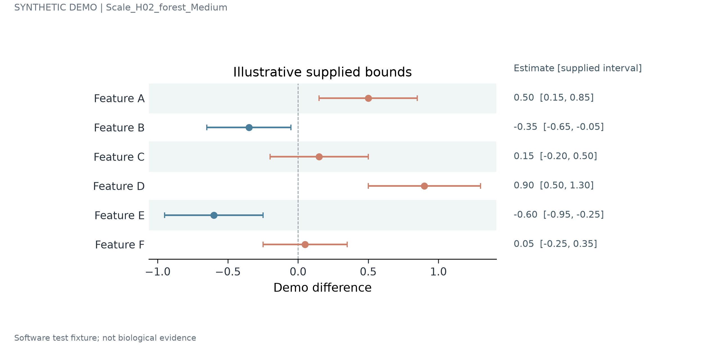
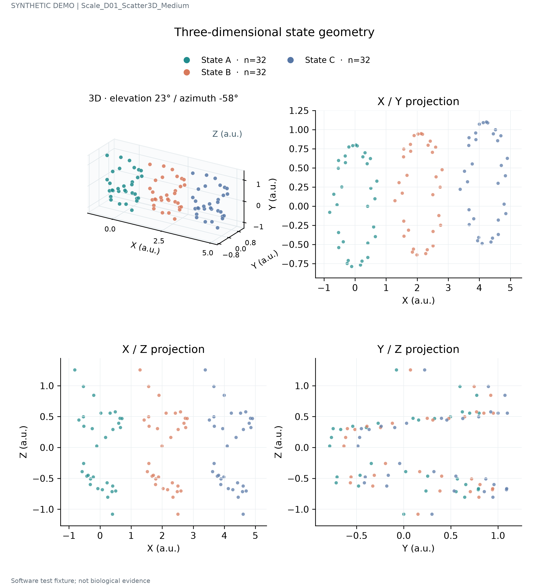
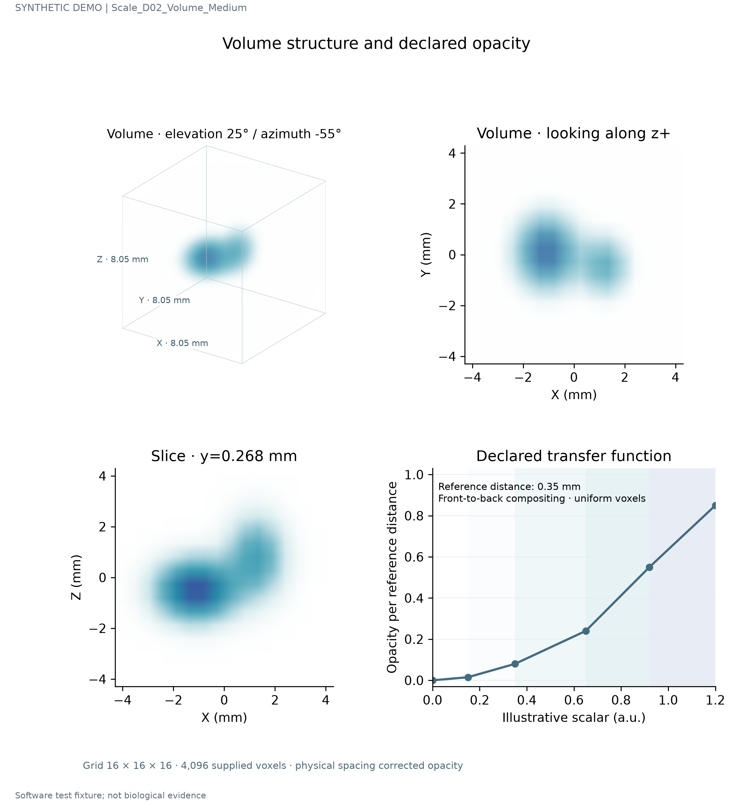
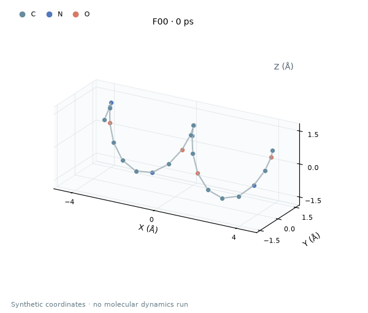

# 综合科研绘图工作台 · Scientific Figure Workbench

**面向多组学、计算生物学与计算机建模，将已经审核的结果表、坐标和帧序列，制作成可追溯、可调整布局的科研图。**

可以作为 **Codex skill** 使用，也可以通过 **独立 Python 命令**调用；原有 R 配方与专用软件接口继续保留。工作台按研究问题与实际数据选择画法，统一课题配色、字体、单位和图例，交付单图、完整配套图及组图。

目录与命令仍使用 `transcriptomics-figure-workbench`，以保持既有安装和调用兼容；当前范围已覆盖转录组以外的多组学、网络、结构、空间数据和模型评价。与 BioResearchWorkbench／Biomni 工具层配合时，仍需分别核对上游分析结果与绘图输入。

[快速上手](#quick-start) · [42 个升级配方](#upgraded-recipes) · [三维与动画实例](#three-dimensional) · [自定义布局](#custom-layout) · [完整分析配套](#analysis-suites) · [安装为 skill](#install-skill) · [检查与来源](#validation)

**当前版本：v0.12.0。** [下载完整 skill 包与 SHA256 校验文件](https://github.com/BoteXu/transcriptomics-figure-workbench/releases/tag/v0.12.0)。包内包含本页的可移植说明、当前全部图库和准确示例；源提交及文档哈希记录在 `RELEASE_SOURCE.json`。版本变化与复现方式见[发布说明](docs/release-v0120.md)。

## v0.12.0：结果交接与同对象联动

增加 `handoff-plan`，直接核验 BioResearchWorkbench 交来的准确结果、QC、方法／参考版本和来源，再进入现有绘图流程。增加 `linked-views`，在多视图中同步选中同一对象，保留固定轴域、完整数据、缺失值、键盘操作和对齐 SVG 导出。它是已有画法的检查扩展，不增加科学分析或模型服务。

[实际可操作的 48／96／144 对象与双列布局](skills/transcriptomics-figure-workbench/assets/connected-examples/index.html) · [来源交接、完整参数与调用](skills/transcriptomics-figure-workbench/references/connected-workflows-v0120.md)。skill 入口按任务重整，旧详细说明和所有旧画法保留。

```sh
python skills/transcriptomics-figure-workbench/scripts/workbench.py handoff-plan --handoff skills/transcriptomics-figure-workbench/assets/connected-examples/handoff/figure-handoff.json --output outputs/handoff-plan.json
python skills/transcriptomics-figure-workbench/scripts/workbench.py render --plan outputs/handoff-plan.json --output outputs/handoff-render
python skills/transcriptomics-figure-workbench/scripts/workbench.py linked-views --request skills/transcriptomics-figure-workbench/assets/connected-examples/medium/request.json --output outputs/linked-medium
```

## 工作台覆盖什么

| 研究与表达场景 | 可选择的画法与配套 | 需要提供的结果 |
|---|---|---|
| Bulk 与单细胞转录组 | QC 云雨图、PCA 椭圆与边缘比例、带堆积分布的火山／MA、GSEA 完整轨道、逐亚群多 marker、供体组成与效应 | 已审核表达／QC 摘要、嵌入坐标、差异与富集结果、独立单位及上游给定密度／区间 |
| 蛋白、代谢、遗传、表观与多组学 | 跨层效应、同对象多视图、因子解释量与载荷、质谱／色谱、位点与候选连接、空间叠加 | 明确对象映射、量尺、参考版本、物理位置、匹配关系与完整选定范围 |
| 网络与功能解释 | WGCNA／hdWGCNA 分阶段配套、模块–性状、TOM、枢纽证据、PPI、调控网络、成员与富集组合 | 已有树、模块、边定义、成员、性状、功能与验证结果 |
| 计算机建模与模型评价 | ROC／PR、校准与人数、训练诊断、贡献分布、多分类解释、给定不确定性、雷达与曲面 | 已有模型输出、真实计数、曲线、贡献值、区间与适用数据范围 |
| 三维与分子结果 | 三维散点与正交投影、规则体素体渲染、分子轨迹关键帧、GIF 和离线播放 | 原始 XYZ、完整规则网格，或原子身份一致的坐标帧、明确键和物理时间 |

**优先选择信息完整、层次清楚的美化画法。** PCA 的给定椭圆和边缘分布、火山图的完整基因分布、云雨图的全部观测、GSEA 的 ES／命中／排序轨道，以及逐亚群多 marker 页面，按实际输入通道选择。缺少云形、区间或分析结果时，需要明确说明依赖。

经典箱线、小提琴、雷达、三维曲面和历史入口仍可选择。同类画法的不同数据量、配色和布局作为扩展保存，单独记录其数据、分母与科学含义。

- [完整跨领域绘图库](skills/transcriptomics-figure-workbench/assets/visual-library/index.html)：按画法、领域和具体实例查找。
- [覆盖清单与真实状态](skills/transcriptomics-figure-workbench/references/visual-library-coverage.md)：区分绘图入口、示例、历史参考与可执行模板。
- [跨领域选图规则](skills/transcriptomics-figure-workbench/references/comprehensive-selection.md)：核对数据兼容性、信息渠道和替代画法。

GitHub 会显示 README 中的 PNG／GIF；交互 HTML 图册与离线播放器需克隆或下载仓库后在浏览器打开。

<a id="quick-start"></a>

## 快速上手：从实际示例到自己的结果

以下命令均从**仓库根目录**运行，适用于 Windows、macOS 和 Linux 的 Python 环境。验收环境使用 Python 3.11；依赖范围以 [requirements.txt](requirements.txt) 为准。使用已有获准绘图的环境，大批量或高分辨率渲染可复用服务器。

### 1. 准备依赖并查找画法

在自己选定的环境中明确安装依赖：

```sh
python -m pip install -r requirements.txt
python skills/transcriptomics-figure-workbench/scripts/workbench.py visual-library --search forest
python skills/transcriptomics-figure-workbench/scripts/workbench.py describe figure_core.plot_forest
```

核心依赖为 NumPy、pandas、Matplotlib 和 Pillow；[requirements-review.txt](requirements-review.txt)另列 PDF 检查与组合辅助依赖。目录检索、模板导出和预检使用标准库，不初始化分析后端。

### 2. 导出模板、预检并绘制

以紧凑表格式森林图为例，名称、效应区间和精确数值分别对齐：



```sh
python skills/transcriptomics-figure-workbench/scripts/workbench.py visual-template --entry Scale_H02_forest_Medium --output outputs/forest-template
python skills/transcriptomics-figure-workbench/scripts/workbench.py plan --spec outputs/forest-template/example.spec.json --output outputs/forest-template/plan.json
python skills/transcriptomics-figure-workbench/scripts/workbench.py render --plan outputs/forest-template/plan.json --output outputs/forest-render
```

- `visual-template` 导出 `example.tsv`、`example.spec.json` 和来源记录；示例导出目录必须尚不存在。
- `plan` 校验输入哈希、字段、参数与绘图器绑定，只进行预检。
- `render` 生成图号子目录，保存 PNG／SVG／PDF、准确 TSV、设置和来源／输出哈希。上例结果位于 `outputs/forest-render/Scale_H02_forest_Medium/`；已有同图号导出会被保留。

### 3. 换成自己的冻结结果

先阅读导出的 FigureSpec 与 `describe` 参数契约，再修改输入表路径、准确 SHA256、数值列、图号、参数和来源说明。需要声明独立单位、比较、分母、缺失值及区间／密度的定义。更改后重新生成计划，输出到新图号或新目录，并查看实际导出。

统一流程为：**选择合适实例 → 绑定准确输入 → 预检 → 绘图 → 检查单图与组图 → 记录审阅**。`RENDERED_UNREVIEWED` 表示已生成文件，仍需视觉检查。

<a id="upgraded-recipes"></a>

## 42 个历史配方，已升级为当前可调用模板

以下 42 个原历史配方均有当前 FigureSpec、准确冻结 TSV、默认／自定义布局、PNG／SVG／PDF 与完整组装示例。表中每行直接链接其实际图片、输入和配置；具体函数映射见[迁移与参数指南](skills/transcriptomics-figure-workbench/references/historical-and-3d-methods.md)。

将快速上手命令中的 `--entry` 换成表中任一 ID，即可使用该配方。例如：

```sh
python skills/transcriptomics-figure-workbench/scripts/workbench.py visual-template --entry H27_running_enrichment --output outputs/enrichment-template
python skills/transcriptomics-figure-workbench/scripts/workbench.py plan --spec outputs/enrichment-template/example.spec.json --output outputs/enrichment-template/plan.json
python skills/transcriptomics-figure-workbench/scripts/workbench.py render --plan outputs/enrichment-template/plan.json --output outputs/enrichment-render
```

| 当前调用 ID | 画法 | 原编号 | 实际示例与准确输入 |
|---|---|---|---|
| `H01_branch_tree` | 已有分支长度树 | `E40` | [PNG](skills/transcriptomics-figure-workbench/assets/method-upgrade-gallery/H01_branch_tree/H01_branch_tree.png) · [TSV](skills/transcriptomics-figure-workbench/assets/method-upgrade-gallery/H01_branch_tree/H01_branch_tree.tsv) · [FigureSpec](skills/transcriptomics-figure-workbench/assets/method-upgrade-gallery/H01_branch_tree/example.spec.json) |
| `H02_forest` | 效应区间森林图 | `P19a` | [PNG](skills/transcriptomics-figure-workbench/assets/method-upgrade-gallery/H02_forest/H02_forest.png) · [TSV](skills/transcriptomics-figure-workbench/assets/method-upgrade-gallery/H02_forest/H02_forest.tsv) · [FigureSpec](skills/transcriptomics-figure-workbench/assets/method-upgrade-gallery/H02_forest/example.spec.json) |
| `H03_volcano` | 火山图 | `P08` | [PNG](skills/transcriptomics-figure-workbench/assets/method-upgrade-gallery/H03_volcano/H03_volcano.png) · [TSV](skills/transcriptomics-figure-workbench/assets/method-upgrade-gallery/H03_volcano/H03_volcano.tsv) · [FigureSpec](skills/transcriptomics-figure-workbench/assets/method-upgrade-gallery/H03_volcano/example.spec.json) |
| `H04_heatmap` | 矩阵热图 | `P12a` | [PNG](skills/transcriptomics-figure-workbench/assets/method-upgrade-gallery/H04_heatmap/H04_heatmap.png) · [TSV](skills/transcriptomics-figure-workbench/assets/method-upgrade-gallery/H04_heatmap/H04_heatmap.tsv) · [FigureSpec](skills/transcriptomics-figure-workbench/assets/method-upgrade-gallery/H04_heatmap/example.spec.json) |
| `H05_paired` | 配对观测轨迹 | `AUX_paired` | [PNG](skills/transcriptomics-figure-workbench/assets/method-upgrade-gallery/H05_paired/H05_paired.png) · [TSV](skills/transcriptomics-figure-workbench/assets/method-upgrade-gallery/H05_paired/H05_paired.tsv) · [FigureSpec](skills/transcriptomics-figure-workbench/assets/method-upgrade-gallery/H05_paired/example.spec.json) |
| `H06_effect_matrix` | 效应与不确定性矩阵 | `P14` | [PNG](skills/transcriptomics-figure-workbench/assets/method-upgrade-gallery/H06_effect_matrix/H06_effect_matrix.png) · [TSV](skills/transcriptomics-figure-workbench/assets/method-upgrade-gallery/H06_effect_matrix/H06_effect_matrix.tsv) · [FigureSpec](skills/transcriptomics-figure-workbench/assets/method-upgrade-gallery/H06_effect_matrix/example.spec.json) |
| `H07_xy_points` | 独立单位散点 | `P33` | [PNG](skills/transcriptomics-figure-workbench/assets/method-upgrade-gallery/H07_xy_points/H07_xy_points.png) · [TSV](skills/transcriptomics-figure-workbench/assets/method-upgrade-gallery/H07_xy_points/H07_xy_points.tsv) · [FigureSpec](skills/transcriptomics-figure-workbench/assets/method-upgrade-gallery/H07_xy_points/example.spec.json) |
| `H08_grouped_estimates` | 分组估计区间 | `P34` | [PNG](skills/transcriptomics-figure-workbench/assets/method-upgrade-gallery/H08_grouped_estimates/H08_grouped_estimates.png) · [TSV](skills/transcriptomics-figure-workbench/assets/method-upgrade-gallery/H08_grouped_estimates/H08_grouped_estimates.tsv) · [FigureSpec](skills/transcriptomics-figure-workbench/assets/method-upgrade-gallery/H08_grouped_estimates/example.spec.json) |
| `H09_confusion_counts` | 给定混淆计数 | `P36` | [PNG](skills/transcriptomics-figure-workbench/assets/method-upgrade-gallery/H09_confusion_counts/H09_confusion_counts.png) · [TSV](skills/transcriptomics-figure-workbench/assets/method-upgrade-gallery/H09_confusion_counts/H09_confusion_counts.tsv) · [FigureSpec](skills/transcriptomics-figure-workbench/assets/method-upgrade-gallery/H09_confusion_counts/example.spec.json) |
| `H10_split_metric_matrix` | 双指标三角矩阵 | `E35` | [PNG](skills/transcriptomics-figure-workbench/assets/method-upgrade-gallery/H10_split_metric_matrix/H10_split_metric_matrix.png) · [TSV](skills/transcriptomics-figure-workbench/assets/method-upgrade-gallery/H10_split_metric_matrix/H10_split_metric_matrix.tsv) · [FigureSpec](skills/transcriptomics-figure-workbench/assets/method-upgrade-gallery/H10_split_metric_matrix/example.spec.json) |
| `H11_hierarchy_tracks` | 已有层次树与轨道 | `E36` | [PNG](skills/transcriptomics-figure-workbench/assets/method-upgrade-gallery/H11_hierarchy_tracks/H11_hierarchy_tracks.png) · [TSV](skills/transcriptomics-figure-workbench/assets/method-upgrade-gallery/H11_hierarchy_tracks/H11_hierarchy_tracks.tsv) · [FigureSpec](skills/transcriptomics-figure-workbench/assets/method-upgrade-gallery/H11_hierarchy_tracks/example.spec.json) |
| `H12_radial_hierarchy` | 已有环形层次树 | `E37` | [PNG](skills/transcriptomics-figure-workbench/assets/method-upgrade-gallery/H12_radial_hierarchy/H12_radial_hierarchy.png) · [TSV](skills/transcriptomics-figure-workbench/assets/method-upgrade-gallery/H12_radial_hierarchy/H12_radial_hierarchy.tsv) · [FigureSpec](skills/transcriptomics-figure-workbench/assets/method-upgrade-gallery/H12_radial_hierarchy/example.spec.json) |
| `H13_stacked_values` | 同单位可加量堆积 | `AUX_c37_terms` | [PNG](skills/transcriptomics-figure-workbench/assets/method-upgrade-gallery/H13_stacked_values/H13_stacked_values.png) · [TSV](skills/transcriptomics-figure-workbench/assets/method-upgrade-gallery/H13_stacked_values/H13_stacked_values.tsv) · [FigureSpec](skills/transcriptomics-figure-workbench/assets/method-upgrade-gallery/H13_stacked_values/example.spec.json) |
| `H14_enrichment_grid` | 已有富集结果点阵 | `E01` | [PNG](skills/transcriptomics-figure-workbench/assets/method-upgrade-gallery/H14_enrichment_grid/H14_enrichment_grid.png) · [TSV](skills/transcriptomics-figure-workbench/assets/method-upgrade-gallery/H14_enrichment_grid/H14_enrichment_grid.tsv) · [FigureSpec](skills/transcriptomics-figure-workbench/assets/method-upgrade-gallery/H14_enrichment_grid/example.spec.json) |
| `H15_term_key` | 条目索引表 | `E06a` | [PNG](skills/transcriptomics-figure-workbench/assets/method-upgrade-gallery/H15_term_key/H15_term_key.png) · [TSV](skills/transcriptomics-figure-workbench/assets/method-upgrade-gallery/H15_term_key/H15_term_key.tsv) · [FigureSpec](skills/transcriptomics-figure-workbench/assets/method-upgrade-gallery/H15_term_key/example.spec.json) |
| `H16_bivariate_tiles` | 双量值色块矩阵 | `E19` | [PNG](skills/transcriptomics-figure-workbench/assets/method-upgrade-gallery/H16_bivariate_tiles/H16_bivariate_tiles.png) · [TSV](skills/transcriptomics-figure-workbench/assets/method-upgrade-gallery/H16_bivariate_tiles/H16_bivariate_tiles.tsv) · [FigureSpec](skills/transcriptomics-figure-workbench/assets/method-upgrade-gallery/H16_bivariate_tiles/example.spec.json) |
| `H17_cohort_intervals` | 队列估计区间 | `P21a` | [PNG](skills/transcriptomics-figure-workbench/assets/method-upgrade-gallery/H17_cohort_intervals/H17_cohort_intervals.png) · [TSV](skills/transcriptomics-figure-workbench/assets/method-upgrade-gallery/H17_cohort_intervals/H17_cohort_intervals.tsv) · [FigureSpec](skills/transcriptomics-figure-workbench/assets/method-upgrade-gallery/H17_cohort_intervals/example.spec.json) |
| `H18_association_matrix` | 关联结果矩阵 | `P18` | [PNG](skills/transcriptomics-figure-workbench/assets/method-upgrade-gallery/H18_association_matrix/H18_association_matrix.png) · [TSV](skills/transcriptomics-figure-workbench/assets/method-upgrade-gallery/H18_association_matrix/H18_association_matrix.tsv) · [FigureSpec](skills/transcriptomics-figure-workbench/assets/method-upgrade-gallery/H18_association_matrix/example.spec.json) |
| `H19_calibration_counts` | 已有校准结果与人数 | `P27` | [PNG](skills/transcriptomics-figure-workbench/assets/method-upgrade-gallery/H19_calibration_counts/H19_calibration_counts.png) · [TSV](skills/transcriptomics-figure-workbench/assets/method-upgrade-gallery/H19_calibration_counts/H19_calibration_counts.tsv) · [FigureSpec](skills/transcriptomics-figure-workbench/assets/method-upgrade-gallery/H19_calibration_counts/example.spec.json) |
| `H20_cross_effects` | 跨组学配对效应 | `M01` | [PNG](skills/transcriptomics-figure-workbench/assets/method-upgrade-gallery/H20_cross_effects/H20_cross_effects.png) · [TSV](skills/transcriptomics-figure-workbench/assets/method-upgrade-gallery/H20_cross_effects/H20_cross_effects.tsv) · [FigureSpec](skills/transcriptomics-figure-workbench/assets/method-upgrade-gallery/H20_cross_effects/example.spec.json) |
| `H21_aligned_views` | 同对象对齐视图 | `M04` | [PNG](skills/transcriptomics-figure-workbench/assets/method-upgrade-gallery/H21_aligned_views/H21_aligned_views.png) · [TSV](skills/transcriptomics-figure-workbench/assets/method-upgrade-gallery/H21_aligned_views/H21_aligned_views.tsv) · [FigureSpec](skills/transcriptomics-figure-workbench/assets/method-upgrade-gallery/H21_aligned_views/example.spec.json) |
| `H22_genomic_links` | 基因组候选连接 | `M08` | [PNG](skills/transcriptomics-figure-workbench/assets/method-upgrade-gallery/H22_genomic_links/H22_genomic_links.png) · [TSV](skills/transcriptomics-figure-workbench/assets/method-upgrade-gallery/H22_genomic_links/H22_genomic_links.tsv) · [FigureSpec](skills/transcriptomics-figure-workbench/assets/method-upgrade-gallery/H22_genomic_links/example.spec.json) |
| `H23_locus_tracks` | 局部位点结果轨道 | `E29` | [PNG](skills/transcriptomics-figure-workbench/assets/method-upgrade-gallery/H23_locus_tracks/H23_locus_tracks.png) · [TSV](skills/transcriptomics-figure-workbench/assets/method-upgrade-gallery/H23_locus_tracks/H23_locus_tracks.tsv) · [FigureSpec](skills/transcriptomics-figure-workbench/assets/method-upgrade-gallery/H23_locus_tracks/example.spec.json) |
| `H24_uncertainty_fan` | 给定多层不确定区间 | `E32` | [PNG](skills/transcriptomics-figure-workbench/assets/method-upgrade-gallery/H24_uncertainty_fan/H24_uncertainty_fan.png) · [TSV](skills/transcriptomics-figure-workbench/assets/method-upgrade-gallery/H24_uncertainty_fan/H24_uncertainty_fan.tsv) · [FigureSpec](skills/transcriptomics-figure-workbench/assets/method-upgrade-gallery/H24_uncertainty_fan/example.spec.json) |
| `H25_typed_network` | 类型互作网络 | `N01` | [PNG](skills/transcriptomics-figure-workbench/assets/method-upgrade-gallery/H25_typed_network/H25_typed_network.png) · [TSV](skills/transcriptomics-figure-workbench/assets/method-upgrade-gallery/H25_typed_network/H25_typed_network.tsv) · [FigureSpec](skills/transcriptomics-figure-workbench/assets/method-upgrade-gallery/H25_typed_network/example.spec.json) |
| `H26_multistate_matrix` | 多事件状态矩阵 | `N07` | [PNG](skills/transcriptomics-figure-workbench/assets/method-upgrade-gallery/H26_multistate_matrix/H26_multistate_matrix.png) · [TSV](skills/transcriptomics-figure-workbench/assets/method-upgrade-gallery/H26_multistate_matrix/H26_multistate_matrix.tsv) · [FigureSpec](skills/transcriptomics-figure-workbench/assets/method-upgrade-gallery/H26_multistate_matrix/example.spec.json) |
| `H27_running_enrichment` | 已有富集运行曲线 | `N08` | [PNG](skills/transcriptomics-figure-workbench/assets/method-upgrade-gallery/H27_running_enrichment/H27_running_enrichment.png) · [TSV](skills/transcriptomics-figure-workbench/assets/method-upgrade-gallery/H27_running_enrichment/H27_running_enrichment.tsv) · [FigureSpec](skills/transcriptomics-figure-workbench/assets/method-upgrade-gallery/H27_running_enrichment/example.spec.json) |
| `H28_contour_field` | 给定等值场 | `N11` | [PNG](skills/transcriptomics-figure-workbench/assets/method-upgrade-gallery/H28_contour_field/H28_contour_field.png) · [TSV](skills/transcriptomics-figure-workbench/assets/method-upgrade-gallery/H28_contour_field/H28_contour_field.tsv) · [FigureSpec](skills/transcriptomics-figure-workbench/assets/method-upgrade-gallery/H28_contour_field/example.spec.json) |
| `H29_process_dashboard` | 流程与结果组合 | `R24` | [PNG](skills/transcriptomics-figure-workbench/assets/method-upgrade-gallery/H29_process_dashboard/H29_process_dashboard.png) · [TSV](skills/transcriptomics-figure-workbench/assets/method-upgrade-gallery/H29_process_dashboard/H29_process_dashboard.tsv) · [FigureSpec](skills/transcriptomics-figure-workbench/assets/method-upgrade-gallery/H29_process_dashboard/example.spec.json) |
| `H30_publication_curve` | 已有 ROC 与 PR 曲线 | `P26a` | [PNG](skills/transcriptomics-figure-workbench/assets/method-upgrade-gallery/H30_publication_curve/H30_publication_curve.png) · [TSV](skills/transcriptomics-figure-workbench/assets/method-upgrade-gallery/H30_publication_curve/H30_publication_curve.tsv) · [FigureSpec](skills/transcriptomics-figure-workbench/assets/method-upgrade-gallery/H30_publication_curve/example.spec.json) |
| `H31_aligned_matrix` | 带对齐注释的矩阵 | `P16a` | [PNG](skills/transcriptomics-figure-workbench/assets/method-upgrade-gallery/H31_aligned_matrix/H31_aligned_matrix.png) · [TSV](skills/transcriptomics-figure-workbench/assets/method-upgrade-gallery/H31_aligned_matrix/H31_aligned_matrix.tsv) · [FigureSpec](skills/transcriptomics-figure-workbench/assets/method-upgrade-gallery/H31_aligned_matrix/example.spec.json) |
| `H32_mantel_matrix` | 已有 Mantel 结果矩阵 | `R07` | [PNG](skills/transcriptomics-figure-workbench/assets/method-upgrade-gallery/H32_mantel_matrix/H32_mantel_matrix.png) · [TSV](skills/transcriptomics-figure-workbench/assets/method-upgrade-gallery/H32_mantel_matrix/H32_mantel_matrix.tsv) · [FigureSpec](skills/transcriptomics-figure-workbench/assets/method-upgrade-gallery/H32_mantel_matrix/example.spec.json) |
| `H33_contribution_swarm` | 给定贡献点分布 | `R10` | [PNG](skills/transcriptomics-figure-workbench/assets/method-upgrade-gallery/H33_contribution_swarm/H33_contribution_swarm.png) · [TSV](skills/transcriptomics-figure-workbench/assets/method-upgrade-gallery/H33_contribution_swarm/H33_contribution_swarm.tsv) · [FigureSpec](skills/transcriptomics-figure-workbench/assets/method-upgrade-gallery/H33_contribution_swarm/example.spec.json) |
| `H34_pca_reference` | 已有 PCA 坐标与区间 | `R18` | [PNG](skills/transcriptomics-figure-workbench/assets/method-upgrade-gallery/H34_pca_reference/H34_pca_reference.png) · [TSV](skills/transcriptomics-figure-workbench/assets/method-upgrade-gallery/H34_pca_reference/H34_pca_reference.tsv) · [FigureSpec](skills/transcriptomics-figure-workbench/assets/method-upgrade-gallery/H34_pca_reference/example.spec.json) |
| `H35_state_dashboard` | 状态结果组合 | `R03` | [PNG](skills/transcriptomics-figure-workbench/assets/method-upgrade-gallery/H35_state_dashboard/H35_state_dashboard.png) · [TSV](skills/transcriptomics-figure-workbench/assets/method-upgrade-gallery/H35_state_dashboard/H35_state_dashboard.tsv) · [FigureSpec](skills/transcriptomics-figure-workbench/assets/method-upgrade-gallery/H35_state_dashboard/example.spec.json) |
| `H36_multiclass_contributions` | 分类贡献分解 | `R11` | [PNG](skills/transcriptomics-figure-workbench/assets/method-upgrade-gallery/H36_multiclass_contributions/H36_multiclass_contributions.png) · [TSV](skills/transcriptomics-figure-workbench/assets/method-upgrade-gallery/H36_multiclass_contributions/H36_multiclass_contributions.tsv) · [FigureSpec](skills/transcriptomics-figure-workbench/assets/method-upgrade-gallery/H36_multiclass_contributions/example.spec.json) |
| `H37_embedding_atlas` | 已有嵌入坐标多视图 | `R04` | [PNG](skills/transcriptomics-figure-workbench/assets/method-upgrade-gallery/H37_embedding_atlas/H37_embedding_atlas.png) · [TSV](skills/transcriptomics-figure-workbench/assets/method-upgrade-gallery/H37_embedding_atlas/H37_embedding_atlas.tsv) · [FigureSpec](skills/transcriptomics-figure-workbench/assets/method-upgrade-gallery/H37_embedding_atlas/example.spec.json) |
| `H38_training_dashboard` | 已有训练曲线组合 | `R14` | [PNG](skills/transcriptomics-figure-workbench/assets/method-upgrade-gallery/H38_training_dashboard/H38_training_dashboard.png) · [TSV](skills/transcriptomics-figure-workbench/assets/method-upgrade-gallery/H38_training_dashboard/H38_training_dashboard.tsv) · [FigureSpec](skills/transcriptomics-figure-workbench/assets/method-upgrade-gallery/H38_training_dashboard/example.spec.json) |
| `H39_activity_dashboard` | 已有活性结果组合 | `R15` | [PNG](skills/transcriptomics-figure-workbench/assets/method-upgrade-gallery/H39_activity_dashboard/H39_activity_dashboard.png) · [TSV](skills/transcriptomics-figure-workbench/assets/method-upgrade-gallery/H39_activity_dashboard/H39_activity_dashboard.tsv) · [FigureSpec](skills/transcriptomics-figure-workbench/assets/method-upgrade-gallery/H39_activity_dashboard/example.spec.json) |
| `H40_effect_distribution_forest` | 给定分布与效应区间 | `R16` | [PNG](skills/transcriptomics-figure-workbench/assets/method-upgrade-gallery/H40_effect_distribution_forest/H40_effect_distribution_forest.png) · [TSV](skills/transcriptomics-figure-workbench/assets/method-upgrade-gallery/H40_effect_distribution_forest/H40_effect_distribution_forest.tsv) · [FigureSpec](skills/transcriptomics-figure-workbench/assets/method-upgrade-gallery/H40_effect_distribution_forest/example.spec.json) |
| `H41_facet_bubble_matrix` | 分面气泡矩阵 | `R20` | [PNG](skills/transcriptomics-figure-workbench/assets/method-upgrade-gallery/H41_facet_bubble_matrix/H41_facet_bubble_matrix.png) · [TSV](skills/transcriptomics-figure-workbench/assets/method-upgrade-gallery/H41_facet_bubble_matrix/H41_facet_bubble_matrix.tsv) · [FigureSpec](skills/transcriptomics-figure-workbench/assets/method-upgrade-gallery/H41_facet_bubble_matrix/example.spec.json) |
| `H42_volcano_marginal` | 火山图与边际分布 | `P10` | [PNG](skills/transcriptomics-figure-workbench/assets/method-upgrade-gallery/H42_volcano_marginal/H42_volcano_marginal.png) · [TSV](skills/transcriptomics-figure-workbench/assets/method-upgrade-gallery/H42_volcano_marginal/H42_volcano_marginal.tsv) · [FigureSpec](skills/transcriptomics-figure-workbench/assets/method-upgrade-gallery/H42_volcano_marginal/example.spec.json) |

### 数据量与布局扩展怎样调用

每个 H01–H42 配方另有 `Scale_<当前ID>_Small`、`_Medium`、`_Large`、`_Custom` 四种可调用示例。例如 `Scale_H02_forest_Large` 与 `Scale_H02_forest_Custom` 使用**完全相同的大档输入**，只调整布局；前三档使用不同的完整冻结输入。

```sh
python skills/transcriptomics-figure-workbench/scripts/workbench.py visual-template --entry Scale_H02_forest_Custom --output outputs/forest-custom-template
```

原始 `H02_forest_Custom` 等布局与旧编号仍保留。完整组装页用于比较同一输入的两种版式，通过 `layout-plan`／`layout-export` 复用；它不是单图 FigureSpec。

[小／中／大与自定义布局实际图册](skills/transcriptomics-figure-workbench/assets/method-scale-gallery/index.html) · [保留的迁移示例](skills/transcriptomics-figure-workbench/assets/method-upgrade-gallery/index.html) · [逐项数据量与检查范围](skills/transcriptomics-figure-workbench/references/method-scale-validation.md)

<a id="three-dimensional"></a>

## 三维散点、体渲染与分子轨迹动画

下面展示的都是仓库中已有的**实际导出**，使用明确标记的合成绘图测试数据。三种方法使用相同的 `visual-template → plan → render` 流程。

### 三维散点：明确相机与完整正交投影



**输入：** `object_id, group, x, y, z`，唯一对象、有限数值、明确轴标签与坐标单位。图中 96 个对象的原始坐标保持不变，三维视角配合完整 XY／XZ／YZ 投影检查遮挡。

```sh
python skills/transcriptomics-figure-workbench/scripts/workbench.py visual-template --entry Scale_D01_Scatter3D_Medium --output outputs/scatter3d-template
python skills/transcriptomics-figure-workbench/scripts/workbench.py plan --spec outputs/scatter3d-template/example.spec.json --output outputs/scatter3d-template/plan.json
python skills/transcriptomics-figure-workbench/scripts/workbench.py render --plan outputs/scatter3d-template/plan.json --output outputs/scatter3d-render
```

**可调：** `views`（仰角／方位角）、`include_projections`、`columns`、`rows`、`width`、`panel_height`。原始入口为 `D01_Scatter3D`，自定义实例为 `Scale_D01_Scatter3D_Custom`。

[准确 TSV](skills/transcriptomics-figure-workbench/assets/method-scale-gallery/Scale_D01_Scatter3D_Medium/Scale_D01_Scatter3D_Medium.tsv) · [完整 FigureSpec](skills/transcriptomics-figure-workbench/assets/method-scale-gallery/Scale_D01_Scatter3D_Medium/example.spec.json) · [SVG](skills/transcriptomics-figure-workbench/assets/method-scale-gallery/Scale_D01_Scatter3D_Medium/Scale_D01_Scatter3D_Medium.svg)

### 体渲染：相机合成、物理切片与显式传递函数



**输入：** `x, y, z, value`，完整均匀规则网格、物理坐标单位、值域、颜色／透明度传递结点和透明度参考距离。此例为 **16³、4,096 个给定体素**，同时显示三维相机、轴向合成、中央切片与传递函数。

```sh
python skills/transcriptomics-figure-workbench/scripts/workbench.py visual-template --entry Scale_D02_Volume_Medium --output outputs/volume-template
python skills/transcriptomics-figure-workbench/scripts/workbench.py plan --spec outputs/volume-template/example.spec.json --output outputs/volume-template/plan.json
python skills/transcriptomics-figure-workbench/scripts/workbench.py render --plan outputs/volume-template/plan.json --output outputs/volume-render
```

**可调：** `camera_views`、`camera_resolution`、`camera_steps`、六个轴向方向的 `views`、`slice_axes`、`transfer` 与行列／尺寸。原始入口为 `D02_Volume`，自定义实例为 `Scale_D02_Volume_Custom`。

实现采用有界正交相机射线与前向透明度合成，按物理步长修正透明度；三线性采样仅服务于图像绘制。缺失体素会被拒绝，需要上游提供完整网格；本入口不提供分割、曲面拟合或 VTK／ParaView 引擎。

[准确 TSV](skills/transcriptomics-figure-workbench/assets/method-scale-gallery/Scale_D02_Volume_Medium/Scale_D02_Volume_Medium.tsv) · [完整 FigureSpec](skills/transcriptomics-figure-workbench/assets/method-scale-gallery/Scale_D02_Volume_Medium/example.spec.json) · [SVG](skills/transcriptomics-figure-workbench/assets/method-scale-gallery/Scale_D02_Volume_Medium/Scale_D02_Volume_Medium.svg)

### 分子轨迹：关键帧、真实 GIF 与离线逐帧播放



**输入：** atom 行包含 `frame_id, time, atom_id, element, chain, x, y, z`，bond 行包含 `source_id, target_id`，通过 `record_type` 区分；所有帧原子身份一致、物理时间严格递增。此例包含 **12 帧、24 个原子、23 条明确键、0–5.5 ps**，为虚构链的绘图演示。

```sh
python skills/transcriptomics-figure-workbench/scripts/workbench.py visual-template --entry Scale_D03_Trajectory_Medium --output outputs/trajectory-template
python skills/transcriptomics-figure-workbench/scripts/workbench.py plan --spec outputs/trajectory-template/example.spec.json --output outputs/trajectory-template/plan.json
python skills/transcriptomics-figure-workbench/scripts/workbench.py render --plan outputs/trajectory-template/plan.json --output outputs/trajectory-render
```

除静态 PNG／SVG／PDF，渲染还输出同图号的 `.gif`、`.html` 播放器与 `.animation.json` 帧时间记录。播放器支持滑块、播放和暂停，可完全离线打开。

**可调：** `key_frames`、固定 `view`、`animation_fps` 与行列／尺寸。播放帧率和输入物理时间分别记录；原始入口为 `D03_Trajectory`，自定义实例为 `Scale_D03_Trajectory_Custom`。原子坐标、键、对齐与周期边界处理均来自明确的上游输入，本入口不运行 MD、猜测键或重新对齐轨迹。

[关键帧 PNG](skills/transcriptomics-figure-workbench/assets/method-scale-gallery/Scale_D03_Trajectory_Medium/Scale_D03_Trajectory_Medium.png) · [离线播放页（下载后打开）](skills/transcriptomics-figure-workbench/assets/method-scale-gallery/Scale_D03_Trajectory_Medium/Scale_D03_Trajectory_Medium.html) · [帧时间记录](skills/transcriptomics-figure-workbench/assets/method-scale-gallery/Scale_D03_Trajectory_Medium/Scale_D03_Trajectory_Medium.animation.json) · [准确 TSV](skills/transcriptomics-figure-workbench/assets/method-scale-gallery/Scale_D03_Trajectory_Medium/Scale_D03_Trajectory_Medium.tsv) · [FigureSpec](skills/transcriptomics-figure-workbench/assets/method-scale-gallery/Scale_D03_Trajectory_Medium/example.spec.json)

三种新增方法均有 `_Small`／`_Medium`／`_Large`／`_Custom` 的 `Scale_` 模板。逐项输入契约、范围与旧 ID 见[三维方法指南](skills/transcriptomics-figure-workbench/references/historical-and-3d-methods.md)。

<a id="custom-layout"></a>

## 按实际数据量调整单图与组图

模板的默认行列是起点。使用时按对象数、marker 数、长标签、目标宽度和阅读顺序调整；完整内容可分成主图与阅读版。换布局后需重新看每张导出，保留全部选定对象、图例、单位和准确表格。

| 调整对象 | 参数或接口 | 核对重点 |
|---|---|---|
| 单图物理尺寸 | FigureSpec 的 `layout.width_inches`／`height_inches`，以及各绘图器的 `size` 等参数 | 支持范围以 `describe` 为准；某些阅读布局会扩大画布，实际尺寸写入记录 |
| 三维／轨迹分面 | `parameters.columns`、`rows`、`width`、`panel_height` | 行列必须装下全部视角、投影、切片或关键帧 |
| 复杂组图 | `layout-plan`／`layout-export`；列宽、跨行跨列、顺序、间距与分页 | 保留源 SVG 的完整坐标与图例，分别检查组件和最终页面 |
| 投稿尺寸 | `export.target_width_mm`、`minimum_text_pt`、`readability_policy: block` | 检查目标物理宽度下字号，再实际看图；数值门禁不能代替审美判断 |

例如在前面已导出的三维散点模板上保存一个新配置，下列 Python 代码可写入脚本后运行：

```python
import json
from pathlib import Path

folder = Path("outputs/scatter3d-template")
spec = json.loads((folder / "example.spec.json").read_text(encoding="utf8"))
spec["figure_id"] = "Scatter3D_TwoViews"
spec["parameters"].update(
    views=[[23, -58], [35, 25]],
    include_projections=True,
    columns=2,
    rows=3,
    width=11.5,
    panel_height=3.3,
)
target = folder / "custom.spec.json"
with target.open("x", encoding="utf8") as stream:
    json.dump(spec, stream, ensure_ascii=False, indent=2)
```

```sh
python skills/transcriptomics-figure-workbench/scripts/workbench.py plan --spec outputs/scatter3d-template/custom.spec.json --output outputs/scatter3d-template/custom.plan.json
python skills/transcriptomics-figure-workbench/scripts/workbench.py render --plan outputs/scatter3d-template/custom.plan.json --output outputs/scatter3d-custom-render
```

完整 SVG 组装也有可直接调用的实际请求：

```sh
python skills/transcriptomics-figure-workbench/scripts/workbench.py layout-plan --request skills/transcriptomics-figure-workbench/assets/method-scale-gallery/Scale_H02_forest_Composition/layout.request.json --output outputs/forest-template/composition.plan.json
python skills/transcriptomics-figure-workbench/scripts/workbench.py layout-export --plan outputs/forest-template/composition.plan.json --output outputs/forest-composition
```

自定义时先复制请求，保留或更新其相对 SVG／TSV 路径，再改 `columns`、`canvas_width_pt`、`packing`、`gap_pt` 与 `padding_pt`。更多见[响应式布局](skills/transcriptomics-figure-workbench/references/responsive-layout-v081.md)与[灵活组图字段](skills/transcriptomics-figure-workbench/references/forms-v080.md#adapt-layout-at-use-time)。

<a id="analysis-suites"></a>

## 按分析取完整配套，支持整套 bulk 与单细胞结果

[58 章分析目录](skills/transcriptomics-figure-workbench/assets/analysis-library/index.html)按输入／QC、主结果、支持证据、功能解释与验证组织。WGCNA／hdWGCNA 包含样本与软阈值、树与模块、TOM、模块–性状、MM–GS、枢纽、功能及保留性／敏感性等配套；其余分析也可按章节取完整集合。

```sh
python skills/transcriptomics-figure-workbench/scripts/workbench.py analysis-library --search WGCNA
python skills/transcriptomics-figure-workbench/scripts/workbench.py analysis-suite --chapter bulk.wgcna --output outputs/wgcna-templates
python skills/transcriptomics-figure-workbench/scripts/workbench.py analysis-render --manifest outputs/wgcna-templates/manifest.json --output outputs/wgcna-render
```

`analysis-suite` 导出该章节的**合成绘图模板与准确输入**；`--include-variants` 可另含替代画法和扩展布局。真实项目使用 `book-plan`／`book-render` 绑定明确清单、来源与上游 QC；普通整套请求用 `study-plan`／`study-render`。没有提供的分析结果仍需上游补齐。

- [常规 bulk／单细胞实际图册](skills/transcriptomics-figure-workbench/assets/routine-gallery/index.html)：PCA、火山、云雨、GSEA、供体和亚群默认画法。
- [逐亚群多 marker 实例](skills/transcriptomics-figure-workbench/assets/subgroup-gallery/index.html)：每个明确身份分别定位、显示跨群特异性与多个 marker，支持可调 marker 数和布局。
- [逐分析配套覆盖](skills/transcriptomics-figure-workbench/references/analysis-companion-coverage-v100.md)与[实际配套图册](skills/transcriptomics-figure-workbench/assets/companion-gallery/index.html)。
- [软件包／方法专用入口](skills/transcriptomics-figure-workbench/references/package-method-entries.md)：明确独立绘图适配器与原生分析软件的区别。

<a id="install-skill"></a>

## 安装、离线浏览与课题主题

### 安装为 Codex skill

任选其一：

1. 在 Codex 中使用 skill-installer，指定仓库 `BoteXu/transcriptomics-figure-workbench`、路径 `skills/transcriptomics-figure-workbench`。
2. 克隆或下载仓库，将 `skills/transcriptomics-figure-workbench/` 放入自己的 Codex skills 目录（通常为 `~/.codex/skills/`）。更新前保留自己定制的主题和私有配置，明确选择替换范围。
3. 使用 [Releases](https://github.com/BoteXu/transcriptomics-figure-workbench/releases) 中所需版本的 skill 包；按对应版本说明核对功能与资产范围。

新会话中可请求：

> 使用 `$transcriptomics-figure-workbench`。根据我提供的已审核 bulk 和单细胞结果，优先选信息完整且美观的画法：PCA 椭圆与边缘比例、带堆积分布的火山图、完整 GSEA、供体云雨及逐亚群多 marker 页面。保留单图和组图，按 marker 数及目标宽度调整布局，逐张检查后交付。

安装 skill 与安装依赖、执行绘图、调用分析软件分别进行。独立 Python 命令不要求配置模型 API 密钥。

### 离线浏览

克隆或下载后，直接在浏览器打开[综合绘图库](skills/transcriptomics-figure-workbench/assets/visual-library/index.html)或[Studio](examples/studio/index.html)；旧[传统图库](examples/gallery/index.html)继续保留。安装版可生成单文件离线 Studio：

```sh
python skills/transcriptomics-figure-workbench/scripts/workbench.py studio --output outputs/figure-studio.html
```

浏览器审美意见保存在本机，可导入／导出；公开仓库分发的是公开示例，不包含私人研究结果。

### 统一课题颜色与字体

使用一个 `project_theme.json` 固定身份–颜色映射、字号层级、顺序／分歧色阶、范围与中心。[15 套色卡与来源](skills/transcriptomics-figure-workbench/references/reference-palette-guide.md)及[课题样式说明](skills/transcriptomics-figure-workbench/references/project-style.md)保留。字体来自目标环境；不分发字体文件。

<a id="validation"></a>

## 检查范围、科学边界与来源

42 个升级配方加 3 种新增方法，已提供 **135 份不同冻结输入、180 张单图及 45 张完整组装页**。Small／Medium／Large 是示例内的相对档位，Custom 与大档同表；225 份导出的图片检查记录绑定最终 PNG 哈希，动画另有逐帧／播放检查。具体范围见[数据量与布局验收](skills/transcriptomics-figure-workbench/references/method-scale-validation.md)和[迁移验收](skills/transcriptomics-figure-workbench/references/method-upgrade-validation.md)。这些数量表示示例和布局，不表示科学分析算法数。

- **保持结果不变：** 不为美化重新拟合差异表达、FDR、富集、PCA／UMAP、聚类、密度、区间、模型或分子坐标。需要的额外通道由上游明确提供。
- **保持科学单位：** 声明物种、模型、方法／参考版本、比较、独立生物学单位、完整选定范围和分母；细胞、点位与模拟帧不自动当作独立样本。
- **按实际导出审阅：** 新数据、字体、标题、指南或尺寸会使旧图片审阅失效。检查每张单图与最终组图的标签、图例、完整性、对比、留白和物理字号；长阅读页与期刊主图分别验收。
- **区分验证层次：** 文件／哈希检查、渲染完成、作者屏幕自检、独立审美评审、纸面校样与科学有效性分别记录。合成演示与软件检查不能证明真实科学结论。
- **保留私人边界：** 私人输入、课题主题、服务器配置、凭据和运行日志留在自己的工作区；公开示例不能成为上传私人结果的授权。

原创实现按 [MIT](LICENSE) 发布；第三方软件、外部数据库、论文、色卡、公共结构坐标和字体保留原始归属与各自许可。具体采用与未采用范围见 [THIRD_PARTY.md](THIRD_PARTY.md)。

[历次 README 设计与版本说明归档](docs/readme-history-before-overview.md)保存原有入口、迁移说明和历史验收范围；当前调用以本页与准确 FigureSpec 为准。

## English overview

**Scientific Figure Workbench for multi-omics, computational biology and computer modelling.** Use it as a Codex skill or through standalone Python commands to turn reviewed frozen tables, coordinates and frame sequences into traceable scientific figures. Select richer compatible displays, preserve quantitative meaning, adapt single and composite layouts, and inspect the actual exports.

All **42 formerly historical-only recipes** now have callable FigureSpecs, exact TSV inputs and real rendered examples. Added methods include **3D scatter with projections, direct volume rendering, and molecular trajectory keyframes, GIFs and offline playback**. The same template → plan → render workflow applies across the workbench; the table above links every upgraded recipe to its actual files. Bulk and single-cell workflows also have analysis-specific companion suites.

Classic forms, radar, 3D surfaces, original IDs and historical examples remain available. Rendering supplied results does not execute upstream analysis or establish scientific validity. Current screen self-review is distinct from independent aesthetic review and print proofing. Code, data sources and third-party tools retain their documented attribution.
