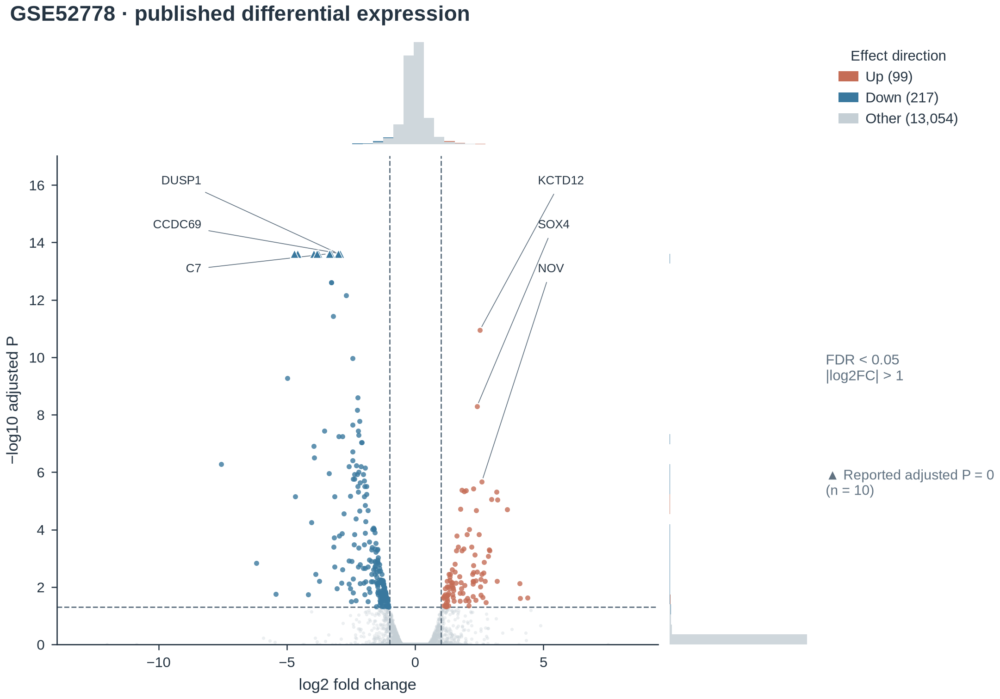
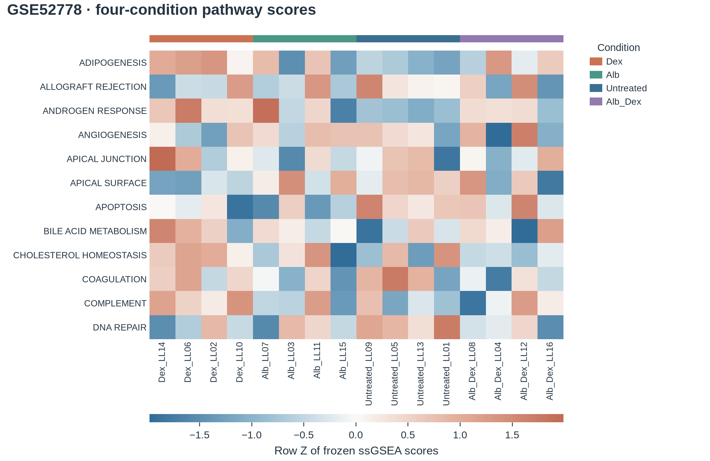

# scientific-visualization v2.2.0 public source

## scientific-visualization v2.2.0：综合绘图工作流公开源码

新增[scientific-visualization](../skills/scientific-visualization/SKILL.md)公开包，覆盖bulk/多组学、单细胞、对接、MD、机器学习、量子化学及QC。保留140个图标识、22个模块、7个复合配方、Python/R以及交互/三维/动画；默认SHAP保留内嵌小玫瑰，其他旧画法可选。[公开版说明与调用](../docs/release-scientific-v220.md)。

原`transcriptomics-figure-workbench` v0.14 引擎、42个历史升级配方、全部旧图册与旧调用保持不变。本仓库为兼容多包分发：根`VERSION`继续表示旧引擎版本，`SCIENTIFIC_VERSION`表示新skill版本，两个数量不相加冒充独立图种。

[16张真实冻结结果示例](../examples/scientific-v220/index.html)按89/183mm逐张检查；附PNG、可编辑SVG和有界结果表。[逐张审阅记录](../examples/scientific-v220/visual_reviews.json)与[数据来源/许可/使用边界](../examples/scientific-v220/PUBLIC_SOURCES.md)明确区分原始数据、已计算通道、样式检查和科学接受。不是本轮重跑全140图或全部交互/三维验收。

| 项目 | 公开版行为 |
| --- | --- |
| 分析衔接 | 71项方法及13条新增原生/导入分支按精确请求、回执、列、单位和QC衔接；不猜样本身份、补造CI或重拟合结果 |
| 隐私 | 移除私人路径、地址、标识、凭据、原始附件指纹及保存技能ID；公开源码不授权上传新项目数据 |
| 实际状态 | 服务器科学引擎本轮未实测；条件/输入/模型许可仍需实际核验，科学接受未建立 |
| 分发 | [scientific-visualization v2.2.0](https://github.com/BoteXu/transcriptomics-figure-workbench/releases/tag/v2.2.0)提供独立skill与单独图册；[旧v0.14完整包](https://github.com/BoteXu/transcriptomics-figure-workbench/releases/tag/v0.14.0)继续可用 |

```text
python -m pip install -r skills/scientific-visualization/requirements.txt
```

按skill中的API调用已有结果绘图；分析代码与服务器准备见[BioResearchWorkbench研究源码](https://github.com/BoteXu/BioResearchWorkbench/tree/v2.17.0/research_kit)。该命令仅列出绘图依赖，发布过程未安装到使用者机器或切换现有默认。

<details><summary>查看实际冻结显示示例（已有结果，不代表新分析）</summary>





</details>


Original maintained integration code is Apache-2.0 in this subpackage; the retained legacy engine remains MIT. Bundled viewer/font and public data terms are separate. No default installation, model weight, personal endpoint or private Git history is published.
